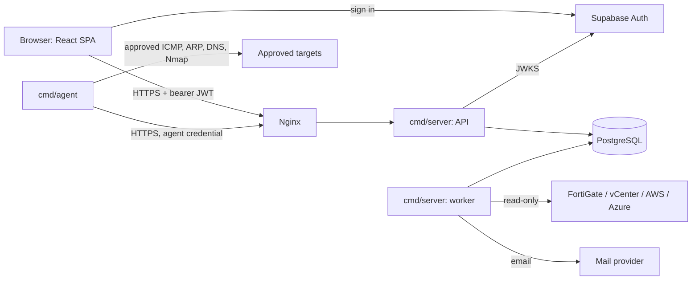
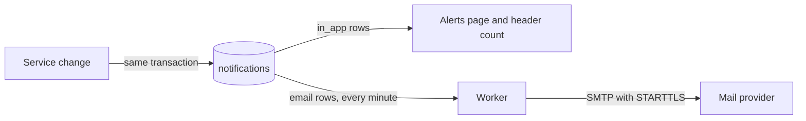

# Architecture

A modular monolith. Modules keep clear boundaries so one can be split out later, but nothing is a microservice today.



## Executables

| Binary | Responsibility |
| --- | --- |
| `cmd/server` | Gin HTTP server, authentication, authorisation, validation and business logic, with the background worker in the same process |
| `internal/worker` | Discovery scheduling, integration sync, reconciliation, utilisation snapshots, reports, reservation and request expiry, email , run by `cmd/server` unless `WORKER_ENABLED=false` |
| `cmd/agent` | Runs inside network segments, or as the optional built-in container on the server: approved ICMP, ARP/NDP, reverse DNS, Nmap host discovery. Pulls jobs and posts results to the API. Never connects to the database |

**Containers:** `web` is Nginx, and the only way in. `backend` runs `cmd/server`. `db` is PostgreSQL. `migrate` runs once and exits, so the database owner's password never sits in a running service. A panic in a background job is caught, so it can't stop the API.

## Repository layout

```text
df-ipam/
├── api/                       # Go backend
│   ├── cmd/{api,worker,agent,migrate,seed}/
│   ├── internal/
│   │   ├── platform/          # config, db, httpx
│   │   ├── auth/              # token verifier interface + Supabase implementation
│   │   ├── audit/
│   │   ├── netcalc/
│   │   └── modules/
│   │       └── subnets/       # one folder per module:
│   │           ├── handler*.go    # HTTP only
│   │           ├── service.go     # business rules, split by topic
│   │           ├── repo*.go       # SQL only
│   │           └── model*.go      # domain types
│   ├── migrations/
│   └── openapi.yaml
├── web/                       # React app
├── deploy/                    # systemd units, nginx config, backup scripts (later)
├── docs/
├── Makefile
└── CLAUDE.md
```

Modules: organisations, sites, zones, routing domains, VDOMs, VLANs, network blocks, subnets, IP addresses, devices, interfaces, allocations, reservations, approvals, discovery, reconciliation, integrations, imports, notifications, reports, administration, users.

**Boundary rule:** a module calls another module's service, never its repository.

**Size rule:** keep files under 200 lines and functions at a cognitive complexity of 15 or less. Split a module by topic, and keep the `store*` and connector file prefixes in `integrations`, because the read-only safety tests find files by them.

**Query rule:** never run a query per row. Read a page with `= ANY($1)`, write a list with `unnest`, and use `pgx.Batch` where each row needs its own statement. Pass user-supplied IDs as `text[]` and cast them in SQL, so a bad ID is a validation error and not a client encoding failure.

## Technology choices

| Need | Choice | Note |
| --- | --- | --- |
| HTTP | Gin | Required |
| Database access | pgx v5 | Required |
| Migrations | golang-migrate | Required |
| Job queue | PostgreSQL with `SKIP LOCKED` | Redis isn't in use: it was never approved |
| Logging | `log/slog` JSON | Standard library |
| IP maths | `net/netip` + `math/big` | IPv6 counts exceed 64 bits |
| JWT and JWKS | `lestrrat-go/jwx` | Used only inside `internal/auth` |
| ICMP | `golang.org/x/net/icmp` | Reverse DNS uses the standard library. SNMP isn't built |
| Integrations | FortiOS REST via `net/http`, `govmomi`, AWS SDK v2, Azure SDK | All read-only |
| Reports | `excelize`, `encoding/csv`, `go-pdf/fpdf` | |
| Frontend | See [frontend.md](frontend.md) | |

## Background jobs

- Every job has a row in Postgres (`discovery_jobs`, `integration_sync_jobs`, `report_jobs`, `import_batches`) recording status, progress and errors.
- Jobs are safe to repeat. Emails retry with backoff, and connector calls with bounded retries.
- Jobs carry the initiating user or a named system actor. Report rights are checked again at download.

## Reliability and performance

Target: thousands of subnets and hundreds of thousands of IP records.

- Connection pooling with `pgxpool`, sized per service
- Queue depth and failed-job monitoring
- Bounded concurrency, with rate limits per network
- Multiple workers can run at once; idempotent imports and deduplication make retries safe
- Failures in one integration or agent don't stop the others
- Retention and archival for observations, heartbeats and job logs

## Notifications



| Built now | Event types |
| --- | --- |
| Allocation workflow | Approval requested, request approved, approved request ready to fulfil, request rejected, request fulfilled, request expired, reservation nearing expiry, reservation expired, reservation released by someone else |
| Other | Integration failed, report ready, change requested, change decided |
| Later | New unknown device, suspected conflict, utilisation threshold, agent offline, discovery failure |

- Notifications are written in the same transaction as the change, so a rolled-back change never notifies anyone.
- Each event has a rule (on or off, severity) and each person chooses in-app and email per event. Everyone starts with everything on.
- A dedupe key per event and object stops repeats reaching the same person twice. People aren't told about their own actions.
- Email rows are an outbox in PostgreSQL. The worker sends a batch every minute with `SKIP LOCKED`, retries with backoff (1, 4, 16, 64 minutes, then at most 4 hours) up to five times, and drops email still unsent after seven days. Without `SMTP_HOST`, email stays off and in-app alerts still work.

## Background jobs in the worker

| Every | Job |
| --- | --- |
| Hour | Reconciliation run, then the daily utilisation snapshot |
| Minute | Worker heartbeat, discovery schedules, integration syncs, expire due reservations, remind holders a week before, expire stale requests, deliver email |
| 15 seconds | Generate queued reports |

All jobs lock their rows with `SKIP LOCKED`, so several workers can run at once, and audit as the `system` actor.

## Reports

Every report runs as a `report_jobs` row in the worker. Every report records its generation timestamp, filters and data freshness, and is built using the requesting user's permissions.
