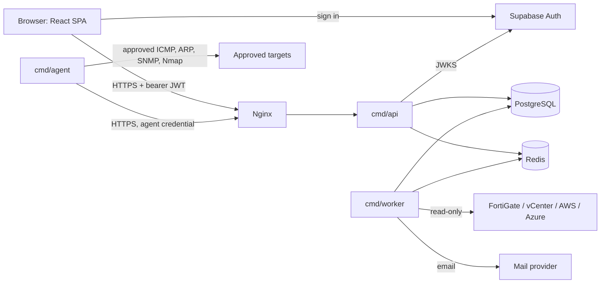

# Architecture

A modular monolith. Modules keep clear boundaries so one can be split out later, but nothing is a microservice today.



## Executables

| Binary | Responsibility |
| --- | --- |
| `cmd/api` | Gin HTTP server, authentication, authorisation, validation, business logic orchestration |
| `cmd/worker` | Discovery scheduling, integration sync, reconciliation, notifications, reports, imports |
| `cmd/agent` | Runs inside network segments: approved ICMP, ARP/NDP, SNMP. Pulls jobs and posts results to the API. Never connects to the database |

## Repository layout

```text
df-ipam/
├── api/                       # Go backend
│   ├── cmd/{api,worker,agent,migrate,seed}/
│   ├── internal/
│   │   ├── platform/          # config, db, httpx
│   │   ├── auth/              # token verifier interface + Supabase implementation
│   │   ├── audit/
│   │   ├── netcalc/
│   │   └── modules/
│   │       └── subnets/       # one folder per module:
│   │           ├── handler.go     # HTTP only
│   │           ├── service.go     # business rules
│   │           ├── repository.go  # SQL only
│   │           ├── model.go       # domain types
│   │           └── dto.go         # request/response types
│   ├── migrations/
│   └── openapi.yaml
├── web/                       # React app
├── deploy/                    # systemd units, nginx config, backup scripts (later)
├── docs/
├── Makefile
└── CLAUDE.md
```

Modules: organisations, sites, zones, routing domains, VDOMs, VLANs, network blocks, subnets, IP addresses, devices, interfaces, allocations, reservations, approvals, discovery, reconciliation, integrations, imports, notifications, reports, administration, users.

**Boundary rule:** a module calls another module's service, never its repository.

## Technology choices

| Need | Choice | Note |
| --- | --- | --- |
| HTTP | Gin | Required |
| Database access | pgx v5 | Required |
| Migrations | golang-migrate | Required |
| Job queue | Asynq on Redis | Needs Redis approval; jobs are also recorded in Postgres so history survives Redis loss |
| Logging | `log/slog` JSON | Standard library, with a redaction layer |
| IP maths | `net/netip` + `math/big` | IPv6 counts exceed 64 bits |
| JWT and JWKS | `lestrrat-go/jwx` | Used only inside `internal/auth` |
| SNMP / DNS / ICMP | `gosnmp`, `miekg/dns`, `pro-bing` | SNMPv3 by default |
| Integrations | FortiOS REST via `net/http`, `govmomi`, AWS SDK v2, Azure SDK | All read-only |
| Reports | `excelize`, `encoding/csv`, a Go PDF library | Chosen in Phase 6 |
| Frontend | See [frontend.md](frontend.md) | |

## Background jobs

- Every job has a row in Postgres (`discovery_jobs`, `integration_sync_jobs`, `report_jobs`, `import_batches`) recording status, progress and errors.
- Jobs are idempotent, with bounded retries and backoff.
- Jobs carry the initiating user or a named system actor, and authorisation is re-checked when they run.

## Reliability and performance

Target: thousands of subnets and hundreds of thousands of IP records.

- Connection pooling with `pgxpool`, sized per service
- Queue depth and failed-job monitoring
- Bounded concurrency, with rate limits per network
- Multiple workers can run at once; idempotent imports and deduplication make retries safe
- Failures in one integration or agent don't stop the others
- Retention and archival for observations, heartbeats and job logs

## Notifications

**Events:** new unknown device, suspected IP conflict, utilisation threshold exceeded, agent offline, scheduled discovery failure, integration authentication failure, approval requested, request approved or rejected, reservation nearing expiry, significant inventory change.

Each event has its own on/off switch, severity and recipient groups, and alerts are deduplicated so people aren't flooded.

The worker consumes events, applies `notification_rules`, deduplicates on a key per event and object, then sends through a `Mailer` interface. The first implementation is SMTP or Microsoft Graph, depending on what the company approves. Delivery status and retries are stored in `notifications`.

## Reports

Small exports stream from the API. Large ones run as `report_jobs`. Every report records its generation timestamp, filters and data freshness, and is built using the requesting user's permissions.
