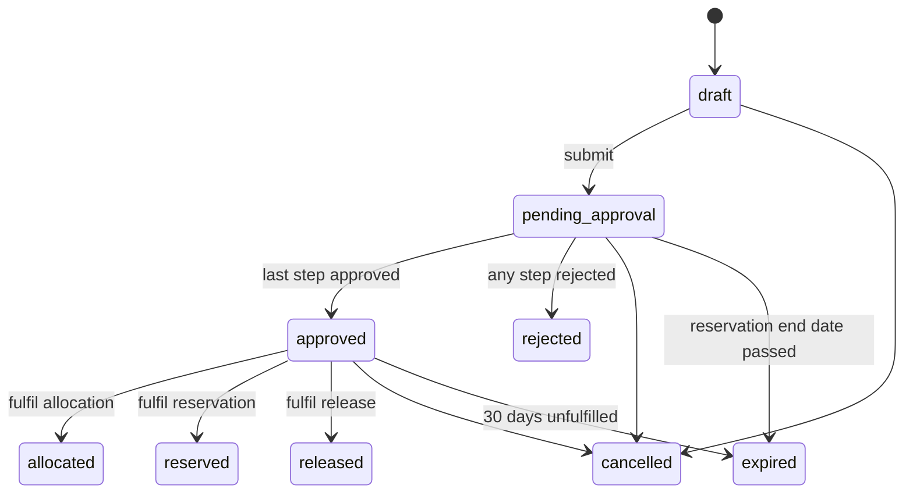

# Database Design

PostgreSQL with native `inet` and `cidr` types. The schema uses standard PostgreSQL plus the `btree_gist` extension, and runs on Supabase PostgreSQL.

## Core rules

- UUID primary keys, `timestamptz` everywhere.
- `created_at`, `updated_at`, `created_by`, `updated_by` on inventory tables.
- Soft deletion (`archived_at`) only for inventory that history refers to. Audit and evidence tables are never soft-deleted.
- Raw observations live in `discovery_observations`, separate from `ip_addresses`.
- Capacity counts use `numeric(39,0)`, because an IPv6 range can hold 2^128 addresses and `bigint` can't store that.

## Full database plan

The whole schema is live on Supabase: 72 application tables plus `schema_migrations`. Migrations are in `api/migrations/`, and `api/sql/supabase-setup.sql` holds everything as one file.

| Area | Purpose | Tables |
| --- | --- | --- |
| Identity and access | Who can do what | `users`, `roles`, `permissions`, `role_permissions`, `user_roles`, `sessions`, `teams`, `team_members` |
| Organisation | Business structure | `organisations`, `business_units`, `sites`, `business_services`, `applications`, `ownership_assignments` |
| Network | Authoritative address inventory | `network_zones`, `routing_domains`, `routing_domain_peerings`, `vdoms`, `vlans`, `network_blocks`, `subnets`, `subnet_reserved_ranges`, `overlap_exceptions`, `ip_addresses`, `subnet_utilisation_snapshots` |
| Devices | Infrastructure inventory | `devices`, `device_interfaces`, `network_routes`, `firewall_address_objects`, `firewall_address_groups`, `firewall_address_group_members` |
| DNS and DHCP | Read-only service data | `dns_records`, `dhcp_scopes`, `dhcp_reservations` |
| Discovery | Controlled collection | `discovery_agents`, `agent_registration_tokens`, `agent_heartbeats`, `discovery_policies`, `discovery_schedules`, `discovery_jobs`, `discovery_job_targets`, `discovery_job_logs`, `discovery_exclusions`, `discovery_blackouts` |
| Evidence | Raw facts, kept apart from inventory | `observation_sources`, `discovery_observations` |
| Reconciliation | Comparing evidence with inventory | `reconciliation_rules`, `reconciliation_results`, `reconciliation_evidence`, `change_requests` |
| Integrations | Read-only connectors | `integration_connections`, `integration_sync_jobs`, `integration_errors`, `external_resource_mappings`, `cloud_accounts`, `cloud_networks` |
| Allocation | Controlled workflow | `approval_workflows`, `approval_workflow_steps`, `ip_requests`, `ip_request_approvals`, `ip_allocations`, `ip_reservations` |
| Governance | Audit and operations | `audit_logs`, `notifications`, `notification_rules`, `notification_preferences`, `report_jobs`, `import_batches`, `import_records`, `saved_filters`, `retention_policies`, `system_settings` |

**Data flow:** connectors and agents write to Evidence. Reconciliation compares Evidence with Network and raises findings. A person approves a `change_request`, and only then does inventory change. Every change writes to `audit_logs` in the same transaction.

**Protection:** every table has row level security on, with access only for `dfipam_app`. `audit_logs`, `discovery_observations` and `discovery_job_logs` are append-only for the app.

**Retention:** `retention_policies` holds starting values for review, not agreed policy: observations 180 days, job logs 90, heartbeats 30, notifications 365, audit logs 2,555.

## Routing context

**Every subnet and IP belongs to a routing domain.** This is what lets the same private range exist in separate VRFs.

The hierarchy in the brief is otherwise flexible. Apart from this, most parent links are nullable, so a subnet doesn't need a VLAN or VDOM. Each organisation gets a `Default` routing domain, so simple cases need no extra setup.

**Network blocks may nest. Subnets may not overlap** in a routing domain, unless a documented exception applies. Blocks are planning containers, and subnets are the actual leaf networks. The subnet hierarchy view is built from block nesting.

## Tested constraints

The results below come from PostgreSQL 18.6 in a throwaway container during design. The schema itself is now live on Supabase (PostgreSQL 17.11), where `make test-db` passes: overlap blocking, exception subnets, renames under an approved overlap, addresses inside subnets, audit immutability, self-approval, frozen job snapshots and Data API closure.

```sql
CREATE EXTENSION IF NOT EXISTS btree_gist;

-- No overlaps within a routing domain; archived subnets and
-- subnets with an approved exception are ignored
ALTER TABLE subnets ADD CONSTRAINT subnets_no_overlap
  EXCLUDE USING gist (routing_domain_id WITH =, cidr inet_ops WITH &&)
  WHERE (archived_at IS NULL AND overlap_exception_id IS NULL);

-- A child row can't disagree with its subnet about routing domain
ALTER TABLE subnets ADD UNIQUE (id, routing_domain_id);
-- ... FOREIGN KEY (subnet_id, routing_domain_id)
--     REFERENCES subnets (id, routing_domain_id)

-- One active allocation per address per routing domain
CREATE UNIQUE INDEX ip_alloc_one_active
  ON ip_allocations (routing_domain_id, address)
  WHERE status = 'active';
```

| Test | Result |
| --- | --- |
| `10.0.0.128/25` inside `10.0.0.0/24`, same routing domain | Rejected |
| Same `10.0.0.0/24` in a different routing domain | Accepted |
| Nested IPv6 (`2001:db8::/120` in `/64`), same routing domain | Rejected |
| Reusing a range after archiving the old subnet | Accepted |
| Duplicate active allocation | Rejected |
| Allocation with a routing domain different from its subnet | Rejected |
| 2^128 stored as `numeric(39,0)` | Stored exactly |
| "Which subnet holds this IP" (`cidr >>= address`) | Used the exclusion constraint's GiST index (with sequential scans disabled to confirm the index is usable) |
| Overlap without an exception | Rejected |
| Overlap with an approved exception | Accepted |
| Removing the exception while the overlap remains | Rejected |
| Address inside two overlapping subnets (`ORDER BY masklen(cidr) DESC`) | Picks the most specific subnet |
| **40 automatic allocations, 20 at a time, on one `/24`** | 40 unique addresses, `.1` to `.40`, no errors |
| Allocating past the end of a `/30` | `.1`, `.2`, then a clean "subnet exhausted" error |

## Overlap exceptions

Supplement §4 allows overlaps in one routing context as a documented exception. Each exception in `overlap_exceptions` records the reason, approver and expiry, and is applied to the specific subnet.

**Known gap, confirmed by test:** a subnet with an exception sits outside the constraint in both directions, so a normal subnet that overlaps it is accepted by the database. The subnet service must therefore check overlaps against exception subnets too, and a trigger should back this up. This has to be built and tested in Phase 1.

Exceptions also don't relax address uniqueness: `(routing_domain_id, address)` stays unique. An address that falls in two subnets belongs to the most specific one.

## Allocation concurrency

Fulfilling an approved request runs in one transaction:

1. Lock the request (`FOR UPDATE`). A request already fulfilled returns its result, so retries are safe.
2. Lock the subnet (`FOR UPDATE`), which serialises automatic selection per subnet.
3. Load the blocked ranges: held records, addresses observed active or in conflict, reserved ranges, DHCP pools, the gateway and more specific subnets. The first gap in the usable range is the candidate. This works on ranges, never single addresses, so it is safe for IPv6.
4. Claim the address with a conditional upsert on its single `ip_addresses` row: it succeeds only if the row is an available candidate in this subnet and not seen in use. A lost race picks the next gap.
5. Insert the allocation or reservation, mark the request fulfilled, write the audit row and the notifications, and commit.

| Guard | Backs up |
| --- | --- |
| `ip_alloc_one_active`, `ip_reservation_one_active` | One active allocation, and one active reservation, per address per routing domain |
| `ip_allocations_not_reserved`, `ip_reservations_not_allocated` triggers | An address is never actively allocated and reserved at once |
| `ip_alloc_one_per_request`, `ip_reservation_one_per_request` | A request is fulfilled at most once |
| `ip_request_approvals_one_per_person` | A person decides at most one step of a request |
| `approvals_no_self` trigger | Nobody approves their own request |

Tested on a real database with separate connections (`make test-db`): 40 automatic allocations 20 at a time get 40 different addresses with no gaps; a full subnet fails cleanly with `SUBNET_EXHAUSTED`; ten allocations and ten reservations racing for one address leave exactly one winner; two approvers deciding one step record one decision; repeated fulfilment creates one allocation.

## Allocation workflow

| Request type | Fulfilled by | Fulfilled status |
| --- | --- | --- |
| `allocation` | `POST /allocations` (`ip:allocate`) | `allocated` |
| `reservation` | `POST /reservations` (`ip:reserve`) | `reserved` |
| `release` | `POST /allocations/:id/release` (`ip:allocate`) | `released` |



At submission the most specific active workflow whose rules match (request type, environment, subnet sensitivity) is copied into `ip_request_approvals`, one row per step with its role. Without a match, one step goes to anyone with `requests:approve`. Later workflow edits don't change requests already submitted.

A reservation ends at the end of its chosen day in UTC. The worker reminds the holder a week before, and on expiry returns the address to the candidate pool. That end date is one a person approved, so it isn't an automatic release in the sense of the safety rules.

## Utilisation definitions

These are the definitions the API uses everywhere:

- **Utilisation** = (allocated + reserved + quarantined records + reserved-range addresses) ÷ usable addresses. An address inside a reserved range is counted once.
- **Available candidates** = usable addresses, minus held records (including retired), reserved ranges, DHCP pools and the gateway. This is calculated from ranges, never by listing addresses.
- DHCP pools block candidates but don't count as utilisation.

## Address calculation

| Case | Total | Usable |
| --- | --- | --- |
| IPv4 standard | 2^(32-n) | Total minus network and broadcast |
| IPv4 `/31` | 2 | 2 (point-to-point, RFC 3021) |
| IPv4 `/32` | 1 | 1 |
| IPv6 standard | 2^(128-n) | Total. No broadcast |
| IPv6 `/127` | 2 | 2 (point-to-point, RFC 6164) |
| IPv6 `/128` | 1 | 1 |
| AWS or Azure subnet | Standard | Minus 5 provider-reserved addresses |

Calculated in Go using `net/netip` and `math/big`. Reserved ranges are stored per subnet, so provider rules are data rather than special cases.

`Available candidate count = usable - allocated - reserved - quarantined - provider-reserved`. It is a candidate count, not a promise that an address is free.

## ERD

Audit fields and many optional links are left out for readability.

```mermaid
erDiagram
  organisations ||--o{ business_units : has
  organisations ||--o{ sites : has
  organisations ||--o{ routing_domains : has
  sites ||--o{ network_zones : contains
  routing_domains ||--o{ vdoms : maps
  devices ||--o{ vdoms : hosts
  vdoms ||--o{ vlans : carries
  sites ||--o{ vlans : scopes
  routing_domains ||--o{ network_blocks : contains
  network_blocks ||--o{ network_blocks : parent
  network_blocks ||--o{ subnets : contains
  routing_domains ||--o{ subnets : contains
  vlans ||--o{ subnets : carries
  subnets ||--o{ ip_addresses : contains
  devices ||--o{ device_interfaces : has
  device_interfaces ||--o{ ip_addresses : binds
  subnets ||--o{ dhcp_scopes : serves
  dhcp_scopes ||--o{ dhcp_reservations : holds
  ip_addresses ||--o{ dns_records : named
  overlap_exceptions ||--o{ subnets : permits
  subnets ||--o{ subnet_utilisation_snapshots : tracks
  teams ||--o{ team_members : has
  users ||--o{ team_members : joins
  teams ||--o{ ownership_assignments : owns
  subnets ||--o{ subnet_reserved_ranges : reserves
  routing_domains ||--o{ routing_domain_peerings : peers
  routing_domains ||--o{ network_routes : routes
  devices ||--o{ firewall_address_objects : holds
  firewall_address_groups ||--o{ firewall_address_group_members : contains
  firewall_address_objects ||--o{ firewall_address_group_members : joins
  cloud_accounts ||--o{ cloud_networks : owns
  routing_domains ||--o{ cloud_networks : maps
  business_services ||--o{ applications : includes
  applications ||--o{ ip_addresses : uses

  ip_requests ||--o{ ip_request_approvals : requires
  ip_requests ||--o| ip_allocations : produces
  ip_addresses ||--o{ ip_allocations : history
  ip_addresses ||--o{ ip_reservations : history
  approval_workflows ||--o{ approval_workflow_steps : defines

  discovery_policies ||--o{ discovery_schedules : drives
  discovery_policies ||--o{ discovery_jobs : governs
  discovery_agents ||--o{ discovery_jobs : runs
  discovery_agents ||--o{ agent_heartbeats : sends
  discovery_jobs ||--o{ discovery_job_targets : freezes
  discovery_jobs ||--o{ discovery_job_logs : logs
  discovery_jobs ||--o{ discovery_observations : produces
  observation_sources ||--o{ discovery_observations : labels
  discovery_observations }o--o{ reconciliation_results : supports

  integration_connections ||--o{ integration_sync_jobs : runs
  integration_connections ||--o{ cloud_accounts : discovers
  integration_connections ||--o{ external_resource_mappings : maps
  integration_sync_jobs ||--o{ integration_errors : logs

  import_batches ||--o{ import_records : contains
  users ||--o{ user_roles : holds
  roles ||--o{ user_roles : grants
  roles ||--o{ role_permissions : includes
  permissions ||--o{ role_permissions : included
```



## Data dictionary

Standard audit columns and `id` are omitted.

### Identity and access

| Table | Key columns | Notes |
| --- | --- | --- |
| `users` | `email`, `display_name`, `auth_provider`, `auth_subject`, `is_active`, `last_login_at` | Unique `(auth_provider, auth_subject)`. Provider-neutral for the auth migration |
| `roles` | `name`, `description`, `is_system` | Six seeded roles |
| `permissions` | `resource`, `action` | Unique pair |
| `role_permissions` | `role_id`, `permission_id` | |
| `user_roles` | `user_id`, `role_id`, `organisation_id?`, `business_unit_id?`, `site_id?`, `business_service_id?` | Null scope means all, except Business Viewer, which requires an explicit business service scope |
| `sessions` | `user_id`, `token_hash`, `source_ip`, `user_agent`, `expires_at`, `revoked_at?` | Unused while Supabase manages sessions; reserved for company auth |

### Infrastructure

| Table | Key columns | Notes |
| --- | --- | --- |
| `organisations` | `name`, `code` | |
| `business_units` | `organisation_id`, `name`, `code` | |
| `sites` | `organisation_id`, `name`, `code`, `site_type`, `address` | Site or data centre |
| `network_zones` | `site_id?`, `name`, `security_zone` | |
| `routing_domains` | `organisation_id`, `name`, `kind`, `route_distinguisher?`, `is_isolated` | `kind`: default, vrf, vpc, vnet, isolated |
| `vdoms` | `device_id`, `routing_domain_id?`, `name` | Unique `(device_id, name)` |
| `vlans` | `vlan_id`, `name`, `site_id?`, `vdom_id?`, `network_zone_id?` | `vlan_id` 1-4094 |
| `network_blocks` | `routing_domain_id`, `parent_id?`, `cidr`, `name`, `purpose` | May nest |
| `subnets` | `routing_domain_id`, `network_block_id?`, `cidr`, `name`, `gateway inet?`, `site_id?`, `network_zone_id?`, `vdom_id?`, `vlan_id?`, `environment`, `security_zone`, `business_service_id?`, `technical_owner_id?`, `business_owner_id?`, `description`, `discovery_enabled`, `discovery_policy_id?`, `discovery_schedule_id?`, `warn_threshold`, `critical_threshold`, `sensitivity`, `business_unit_id?`, `overlap_exception_id?`, `version`, `archived_at?` | Mask, network, broadcast and usable range are calculated. `environment`: production, disaster_recovery, uat, development, testing |
| `ip_addresses` | `routing_domain_id`, `subnet_id`, `address inet`, `hostname`, `fqdn`, `mac macaddr?`, `device_id?`, `interface_id?`, `application_id?`, `business_service_id?`, `owner_id?`, `allocation_state`, `observation_state`, `confidence_score`, `confidence_explanation`, `discovery_source_id?`, `first_seen`, `last_seen`, `last_verified`, `notes` | Unique `(routing_domain_id, address)`. Family derived with `family(address)`. Device type, vendor, OS, site and location come through the device or subnet. OS is shown only when reliably identified. Rows exist only for addresses of interest, never one per possible address |
| `devices` | `name`, `hostname`, `management_ip?`, `vendor`, `model`, `serial_number?`, `device_type`, `os_version`, `os_family`, `site_id?`, `environment?`, `owner_id?`, `business_service_id?`, `source_system`, `external_id`, `first_discovered`, `last_discovered`, `last_verified`, `status`, `sensitivity`, `notes` | `sensitivity` drives discovery rules; sensitive devices are passive/API-only by default |
| `device_interfaces` | `device_id`, `name`, `mac?`, `interface_type`, `admin_status`, `oper_status`, `vlan_id?`, `vdom_id?`, `routing_domain_id?`, `description`, `source`, `last_observed` | Unique `(device_id, vdom_id, name)`, nulls not distinct. IPs link via `ip_addresses.interface_id` |
| `business_services` | `name`, `criticality`, `is_sensitive` | Sensitive services default to passive discovery |
| `applications` | `name`, `business_service_id?` | Addition to the brief |
| `teams` | `name`, `email`, `description` | Responsible teams. Addition to the brief |
| `team_members` | `team_id`, `user_id` | Addition to the brief |
| `ownership_assignments` | `object_type`, `object_id`, `owner_type`, `user_id?`, `team_id?`, `valid_from`, `valid_to?` | Owner history |
| `dns_records` | `routing_domain_id?`, `ip_address_id?`, `name`, `record_type`, `value`, `ttl`, `source_id`, `last_seen` | A, AAAA, PTR, CNAME. Inventory from read-only sources; DF-IPAM never changes DNS. Addition to the brief |
| `subnet_reserved_ranges` | `subnet_id`, `range_start`, `range_end`, `reason`, `provider` | Provider-reserved and manual ranges, counted in utilisation |
| `routing_domain_peerings` | `domain_a_id`, `domain_b_id`, `kind`, `source_id`, `last_seen` | Recorded links, such as VNet peering. They don't merge domains |
| `network_routes` | `routing_domain_id?`, `device_id?`, `vdom_id?`, `destination cidr`, `next_hop inet?`, `interface_id?`, `route_type`, `source_id`, `last_seen` | Static routes and cloud route tables |
| `firewall_address_objects` | `device_id`, `vdom_id?`, `name`, `object_type`, `value`, `network cidr?`, `comment`, `last_seen` | FortiGate address objects |
| `firewall_address_groups` | `device_id`, `vdom_id?`, `name`, `comment`, `last_seen` | FortiGate address groups |
| `firewall_address_group_members` | `group_id`, `object_id` | Join table |
| `dhcp_scopes` | `subnet_id`, `name`, `range_start inet`, `range_end inet`, `server_device_id?`, `source_id`, `last_seen` | Addresses in a scope are not offered as candidates. Addition to the brief |
| `dhcp_reservations` | `scope_id`, `address inet`, `mac`, `hostname`, `source_id`, `last_seen` | Addition to the brief |
| `overlap_exceptions` | `reason`, `approved_by`, `approved_at`, `expires_at?` | Addition to the brief |
| `subnet_utilisation_snapshots` | `subnet_id`, `captured_at`, `allocated`, `reserved`, `observed_active`, `utilisation_pct` | Daily, for trend reports. Addition to the brief |

### Discovery

| Table | Key columns | Notes |
| --- | --- | --- |
| `discovery_agents` | `name`, `site_id?`, `status`, `credential_hash`, `credential_rotated_at`, `revoked_at?`, `version`, `last_heartbeat_at` | |
| `discovery_policies` | `name`, `methods[]`, `target_allowlist cidr[]`, `max_concurrency`, `max_pps`, `timeout_ms`, `retries`, `windows jsonb`, `is_sensitive`, `approved_by?`, `approved_at?` | |
| `discovery_schedules` | `policy_id`, `cron`, `timezone`, `subnet_id?`, `agent_id?`, `priority`, `is_enabled` | |
| `discovery_jobs` | `policy_id?`, `agent_id?`, `status`, `priority`, `config_snapshot jsonb`, `progress`, `error`, `started_at`, `finished_at`, `initiated_by` | Snapshot immutable |
| `discovery_job_targets` | `job_id`, `routing_domain_id`, `target cidr`, `checkpoint?`, `status` | Frozen scope. `checkpoint` lets a job resume |
| `discovery_job_logs` | `job_id`, `level`, `message`, `logged_at` | Scan logs and errors. Addition to the brief |
| `discovery_observations` | `job_id?`, `sync_job_id?`, `source_id`, `routing_domain_id?`, `address inet?`, `mac?`, `hostname?`, `payload jsonb`, `observed_at` | Append-only. Partition by month as volume grows |
| `observation_sources` | `name`, `kind`, `reliability`, `priority` | |
| `reconciliation_results` | `classification`, `object_type`, `object_id?`, `routing_domain_id?`, `address?`, `sources`, `evidence_from`, `evidence_to`, `source_reliability`, `confidence`, `explanation`, `suggested_action`, `review_status`, `reviewed_by?`, `reviewed_at?` | Linked to evidence through `reconciliation_evidence` |
| `reconciliation_evidence` | `result_id`, `observation_id` | Join table |
| `discovery_exclusions` | `target cidr`, `routing_domain_id?`, `reason`, `expires_at?` | Always wins over allowlists |
| `agent_registration_tokens` | `agent_id?`, `token_hash`, `created_by`, `expires_at`, `used_at?` | Single-use, stored only as a hash |
| `discovery_blackouts` | `name`, `target cidr?`, `starts_at`, `ends_at`, `reason` | Maintenance periods when no active discovery runs |
| `reconciliation_rules` | `classification`, `source_priority jsonb`, `confidence_weights jsonb`, `is_enabled` | Configurable priorities and confidence |
| `agent_heartbeats` | `agent_id`, `received_at`, `version`, `metrics jsonb` | Pruned by retention |

### Integrations

| Table | Key columns | Notes |
| --- | --- | --- |
| `integration_connections` | `kind`, `name`, `base_url?`, `config jsonb`, `credential_ciphertext`, `key_version`, `health`, `last_success_at` | Credentials never leave the service layer |
| `integration_sync_jobs` | `connection_id`, `status`, `counts jsonb`, `started_at`, `finished_at` | |
| `external_resource_mappings` | `connection_id`, `resource_type`, `external_id`, `object_type`, `object_id`, `last_seen` | Unique on the first three |
| `cloud_accounts` | `connection_id`, `provider`, `external_account_id`, `tenant_id?`, `name`, `last_seen` | AWS accounts and Azure subscriptions |
| `cloud_networks` | `cloud_account_id`, `routing_domain_id?`, `region`, `resource_group?`, `external_id`, `name`, `address_spaces cidr[]`, `last_seen` | VPCs and VNets |
| `integration_errors` | `sync_job_id`, `code`, `message`, `context jsonb`, `occurred_at` | Redacted |

### Governance

| Table | Key columns | Notes |
| --- | --- | --- |
| `ip_requests` | `request_type`, `subnet_id`, `requested_address?`, `selection_mode`, `allocation_id?`, `reservation_id?`, `workflow_id?`, `version`, `submitted_at`, `decided_at`, `fulfilled_at`, `fulfilled_by`, `application_id?`, `business_service_id?`, `justification`, `department`, `technical_owner_id`, `business_owner_id`, `environment`, `required_date`, `expiry_date?`, `comments`, `status`, `requested_by` | `request_type`: allocation, reservation, release. Status: draft, pending_approval, approved, rejected, allocated, reserved, released, cancelled, expired (submitted is kept for compatibility) |
| `ip_request_approvals` | `request_id`, `step_order`, `approver_role_id?`, `approver_id?`, `decision`, `comment`, `decided_at` | No self-approval: service rule plus a trigger comparing `approver_id` with the request's `requested_by` |
| `approval_workflows` | `name`, `match_rules jsonb`, `is_active` | Addition to the brief |
| `approval_workflow_steps` | `workflow_id`, `step_order`, `approver_role_id` | Addition to the brief |
| `ip_allocations` | `ip_address_id`, `subnet_id`, `routing_domain_id`, `address`, `request_id?`, `release_request_id?`, `status`, `allocated_by`, `allocated_at`, `released_by?`, `released_at?` | Partial unique index above. Releases also go through approval |
| `ip_reservations` | `ip_address_id`, `subnet_id`, `routing_domain_id`, `address`, `status`, `reason`, `expires_at?`, `request_id?`, `reserved_by`, `released_by?`, `released_at?`, `reminded_at?` | Same partial unique pattern |
| `change_requests` | `object_type`, `object_id`, `proposed jsonb`, `status`, `requested_by`, `decided_by?` | Used for reconciliation-driven changes |
| `audit_logs` | `actor_id?`, `actor_type`, `action`, `object_type`, `object_id`, `old_values jsonb`, `new_values jsonb`, `occurred_at`, `source_ip`, `correlation_id`, `approval_ref?`, `result` | App role has `INSERT` and `SELECT` only; a trigger also blocks changes |
| `notifications` | `event_type`, `severity`, `recipient_id?`, `channel`, `dedupe_key`, `payload jsonb`, `object_type?`, `object_id?`, `status`, `attempts`, `last_error?`, `next_attempt_at?`, `sent_at?`, `read_at?` | |
| `notification_rules` | `event_type`, `severity`, `recipient_group`, `is_enabled` | Addition to the brief |
| `report_jobs` | `report_type`, `format`, `filters jsonb`, `status`, `file_path?`, `data_as_of`, `requested_by` | |
| `import_batches` | `file_name`, `file_hash`, `format`, `status`, `summary jsonb`, `approved_by?`, `reversed_at?`, `uploaded_by` | |
| `import_records` | `batch_id`, `line_number`, `raw_text`, `parsed jsonb`, `status`, `errors jsonb`, `created_object_type?`, `created_object_id?` | Every source line is kept |
| `notification_preferences` | `user_id`, `event_type`, `channel`, `is_enabled` | Per-user choices |
| `retention_policies` | `data_class`, `retain_days`, `archive_first` | Editable retention periods |
| `saved_filters` | `user_id`, `page`, `name`, `filters jsonb` | Addition to the brief |
| `system_settings` | `key`, `value jsonb` | Includes the emergency stop flag |

## Seed data and test factories

- `df-ipam seed` loads roles, permissions, observation sources and default settings. It is safe to run more than once.
- A separate demo seed provides sample data for development and is blocked in production.
- Go test factories build valid records for integration tests.

## Key indexes

| Index | Purpose |
| --- | --- |
| GiST from the exclusion constraint | Overlap checks |
| GiST on `network_blocks (cidr inet_ops)` | Containment |
| GiST on `subnets (routing_domain_id, cidr inet_ops)`, partial on active rows | Containment including exception subnets, which the constraint's index omits |
| Unique on `ip_addresses (routing_domain_id, address)` | Identity and range scans |
| B-tree on `ip_addresses (subnet_id, allocation_state)` | Utilisation counts |
| B-tree on `ip_addresses (mac)`, `(lower(hostname))`, `(lower(fqdn))` | Explorer search |
| B-tree on `discovery_observations (address, observed_at DESC)` | Evidence history |
| B-tree on `audit_logs (object_type, object_id, occurred_at DESC)` | Record history |
