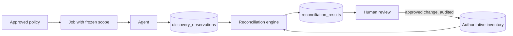

# Discovery and Reconciliation

Discovery produces **evidence**. Reconciliation compares evidence with inventory and raises findings. People decide what changes.

## What evidence means

| Source | Tells you | Does not tell you |
| --- | --- | --- |
| ICMP | Reachable now | Allocation or ownership. No reply does not mean free |
| ARP / NDP | Local-segment IP to MAC mapping | Anything across a routed hop |
| DNS | A name exists | That the host is active |
| SNMP | What a device reports (read-only) | Anything about devices not polled |
| Nmap | Host is up (narrow host discovery) | OS or services: these scans are off by default |
| FortiGate / vCenter / cloud | What the platform has configured | Current truth. VMware Tools data may be stale |

## Discovery methods

| Method | Behaviour |
| --- | --- |
| ICMP | Echo requests with configurable concurrency, timeout, retries, rate limit and scan window. Replies are stored as observations |
| ARP / NDP | Read from the agent host's own neighbour tables, so a segment needs its own agent. FortiGate ARP comes through the connector |
| DNS | Reverse lookups, at most 20 a second, through the agent host's resolver |
| SNMP | **Not built.** A policy may list it, and the agent logs that it isn't collected. It needs SNMPv3 credential storage |
| Nmap | Host discovery only (`-sn`) on approved ranges, if Nmap is installed on the agent host |
| DHCP | Scopes and leases through integrations, read-only |

## Safety controls

Every job passes all of these on the server. The limits that can change are checked again between targets, and every result is checked against the scope.

1. Target is inside an explicit **allowlist**.
2. Target is not in `discovery_exclusions`. Exclusions always win.
3. Target is not classified as sensitive, at subnet level or through its business service. Core banking, payment switching and other sensitive systems are **passive/API-only** until explicitly authorised.
4. Time is inside the policy's window and outside maintenance blackouts.
5. Policy has the required approval.
6. The global **emergency stop** is off. The button appears only while jobs are queued, running or paused, or if their status can't be read. Turning it on stops those jobs, tells agents to halt at their next heartbeat (within 15 seconds), and blocks new scans until someone with `discovery:manage` lifts it.

Users can't get around scopes with their own input: manual runs can only select from approved scopes.

Each policy sets maximum concurrency, packet rate, timeout and retries. Hard ceilings cap what a policy may ask for: see Traffic limits below.

Defaults:

- Nmap runs host discovery only, with fixed arguments. User input is never passed to the command line. OS detection, service scans and scripts are not available.
- Large IPv6 subnets are not swept. They rely on neighbour tables, DNS, integrations and known addresses.

## Scheduling and jobs

- Jobs start by hand, or from a schedule on one subnet. Either can be pinned to one agent, and jobs have a priority.
- States: `queued`, `running`, `paused`, `completed`, `failed`, `cancelled`, `stopped`.
- At creation, a job stores an **immutable snapshot** of its approved targets and configuration. Later policy edits do not affect it.
- Retention rules prune old job detail, and audit records are kept.
- A job resumes from its unfinished targets, and is safe to repeat: results only add observations, so a rerun can't duplicate authoritative records.
- Several agents can run at once. One ceiling covers all of them, and two jobs can't scan overlapping targets at the same time.

## Agents

- **Where they run:** a local agent runs on a host inside a segment. The optional built-in agent runs in a container on the server and scans what the server can route to, without ARP from remote segments. Any number of both can run together, under the same limits and emergency stop. A job with no agent goes to whichever asks first, so pin a job when only one agent can reach its targets.
- **Registration:** an administrator creates a single-use, expiring token. The agent exchanges it for its own credential.
- **Authentication:** each agent has its own credential, stored only as a hash.
- **Least privilege:** an agent can only fetch its own jobs, and post results and heartbeats. It runs as a dedicated user with `CAP_NET_RAW` only, not root.
- **Lifecycle:** revocation takes effect on the next request. Rotation issues a new one-time token, and the old credential works until the agent registers with it. A token left in place after use is ignored with a warning, so a restart can't stop the agent.
- **Health:** heartbeats go to `agent_heartbeats` every 15 seconds. An agent silent for 5 minutes shows as offline. No alert is sent yet.

## Reconciliation

Runs on demand and hourly from the worker. The rules are in `api/internal/modules/reconciliation/rules.go`, and `reconciliation_rules` sets each classification's source priority, confidence weights and whether it runs. Switching one off stops detection without resolving its findings. A rerun updates the same finding, resolves findings no longer true, and leaves dismissed findings dismissed.

All matching is done **within a routing domain**.

Sources: authoritative allocations, manual inventory, FortiGate, VMware, AWS, Azure, DNS, DHCP, SNMP, ARP, ICMP and Nmap.

Findings: new device, unknown IP, suspected IP conflict, duplicate MAC, DNS mismatch, allocated but not recently observed, observed but not allocated, subnet overlap, ownership missing, infrastructure inventory mismatch, stale evidence.

Every result stores: the object, routing context, sources, evidence timestamps, source reliability, confidence, explanation, suggested action and review status (`open`, `investigating`, `accepted`, `dismissed`, `resolved`).

### Rules that must hold

- The same private IP in isolated routing domains is not a conflict.
- Multiple MACs alone do not prove a conflict. Check for HA pairs, virtual IPs and load balancers first; without other evidence the finding stays low confidence.
- No ICMP reply never marks an allocated IP as free.
- Results never overwrite authoritative records. Changes go through administrator review as a `change_request`.

### What discovery may write

| May update | May never update |
| --- | --- |
| `observation_state`, `first_seen`, `last_seen`, `last_verified`, `confidence_score`, `confidence_explanation` | `allocation_state`, owner, business service, application, allocation or reservation records |

The worker's code path has no method for the right-hand column, and tests check this.

### Confidence score

A 0-100 score built from source reliability, evidence age and agreement between sources, with each contribution saved in `confidence_breakdown` so the UI can explain it. The weights add up to 1, and a cap keeps weak findings low: several MACs alone never pass 50. Classifications with no weights keep the fixed confidence in their rule. The starting weights are in the seed and need review.

## Traffic limits

Discovery must never harm the network it maps. These limits hold together:

| Limit | Value | Enforced by |
| --- | --- | --- |
| All discovery at once | `discovery.max_total_pps`, default 100, never above 500 | API: an agent only receives what is left of the ceiling |
| One policy | 1 to 500 packets a second, 1 to 64 probes at once | API, then the agent again |
| One agent | `AGENT_MAX_PPS`, and a built-in ceiling of 500 | Agent, whatever the job says |
| Every packet | Retries wait for the rate limiter too | Agent |
| Reverse DNS | 20 lookups a second | Agent |
| One job | 65,536 addresses, 512 targets | API |
| One schedule | At most every 15 minutes, whatever its cron says | Worker |
| Address types | Multicast, loopback and link-local are never swept | API and agent |

**Limits that change mid-job:** after each target the API checks the job again. A closed maintenance window puts the job back in the queue for its next window. A new exclusion or blackout closes the targets it touches, even if it only covers part of one, and they are skipped before any packet goes out.

**Losing the server:** an agent that hears nothing for 90 seconds stops its job, because it can no longer receive the emergency stop.
