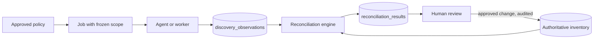

# Discovery and Reconciliation

Discovery produces **evidence**. Reconciliation compares evidence with inventory and raises findings. People decide what changes.

## What evidence means

| Source | Tells you | Does not tell you |
| --- | --- | --- |
| ICMP | Reachable now | Allocation or ownership. No reply does not mean free |
| ARP / NDP | Local-segment IP to MAC mapping | Anything across a routed hop |
| DNS | A name exists | That the host is active |
| SNMP | What a device reports (read-only) | Anything about devices not polled |
| Nmap | Host is up (narrow host discovery) | OS or services: these scans are off by default |
| FortiGate / vCenter / cloud | What the platform has configured | Current truth. VMware Tools data may be stale |

## Discovery methods

| Method | Behaviour |
| --- | --- |
| ICMP | Echo requests with configurable concurrency, timeout, retries, rate limit and scan window. Replies are stored as observations |
| ARP / NDP | Collected from approved local collectors, routers, switches and firewalls, and linked to interface, VLAN and routing context |
| DNS | Forward and reverse lookups for A, AAAA, PTR and relevant CNAME records, with mismatch detection |
| SNMP | Read-only interface, neighbour, identity and network data, using standard MIBs. Each vendor extension is documented before use |
| Nmap | Narrow host discovery on approved ranges |
| DHCP | Scopes and leases through integrations, read-only |

## Safety controls

Every job passes all of these before it starts, enforced on the server. The agent re-checks them too.

1. Target is inside an explicit **allowlist**.
2. Target is not in `discovery_exclusions`. Exclusions always win.
3. Target is not classified as sensitive, at subnet or device level. Core banking, payment switching and other sensitive systems are **passive/API-only** until explicitly authorised.
4. Time is inside the policy's window and outside maintenance blackouts.
5. Policy has the required approval.
6. The global **emergency stop** is off. Turning it on cancels queued discovery, tells running agents to stop, and blocks new scans until an administrator clears it.

Users can't get around scopes with their own input: manual runs can only select from approved scopes.

Each policy sets maximum concurrency, packet rate, timeout and retries. Server-side hard ceilings cap what a policy may ask for.

Defaults:

- SNMPv3 only. SNMPv2c needs a documented, approved exception.
- Nmap runs host discovery only, with fixed arguments. User input is never passed to the command line. OS detection, service scans and scripts are not available.
- Large IPv6 subnets are not swept. They rely on neighbour tables, DNS, integrations and known addresses.

## Scheduling and jobs

- Supports manual, per-subnet and per-agent schedules, with priorities and queues.
- States: `queued`, `running`, `paused`, `completed`, `failed`, `cancelled`, `stopped`.
- At creation, a job stores an **immutable snapshot** of its approved targets and configuration. Later policy edits do not affect it.
- Bounded retries with backoff. Retention rules prune old job detail, and audit records are kept.
- Jobs are resumable from per-target checkpoints, and safe to retry: results only add observations, so a rerun can't duplicate authoritative records.
- Multiple workers and agents can run at once. Limits apply per network, so several agents can't add up to more than one network's rate limit.

## Agents

- **Registration:** an administrator creates a single-use, expiring token. The agent exchanges it for its own credential.
- **Authentication:** each agent has its own credential, stored only as a hash. mTLS can be added later.
- **Least privilege:** an agent can only fetch its own jobs, and post results and heartbeats. It runs as a dedicated user with `CAP_NET_RAW` only, not root.
- **Lifecycle:** revocation takes effect on the next request. Rotation overlaps old and new credentials briefly.
- **Health:** heartbeats go to `agent_heartbeats`. Missed heartbeats raise an offline alert.

## Reconciliation

Runs on demand and hourly from the worker. The rules are in `api/internal/modules/reconciliation/rules.go`, and `reconciliation_rules` sets each classification's source priority, confidence weights and whether it runs. Switching one off stops detection without resolving its findings. A rerun updates the same finding, resolves findings no longer true, and leaves dismissed findings dismissed.

All matching is done **within a routing domain**.

Sources: authoritative allocations, manual inventory, FortiGate, VMware, AWS, Azure, DNS, DHCP, SNMP, ARP, ICMP and Nmap.

Findings: new device, unknown IP, suspected IP conflict, duplicate MAC, DNS mismatch, allocated but not recently observed, observed but not allocated, subnet overlap, ownership missing, infrastructure inventory mismatch, stale evidence.

Every result stores: the object, routing context, sources, evidence timestamps, source reliability, confidence, explanation, suggested action and review status (`open`, `investigating`, `accepted`, `dismissed`, `resolved`).

### Rules that must hold

- The same private IP in isolated routing domains is not a conflict.
- Multiple MACs alone do not prove a conflict. Check for HA pairs, virtual IPs and load balancers first; without other evidence the finding stays low confidence.
- No ICMP reply never marks an allocated IP as free.
- Results never overwrite authoritative records. Changes go through administrator review as a `change_request`.

### What discovery may write

| May update | May never update |
| --- | --- |
| `observation_state`, `first_seen`, `last_seen`, `last_verified`, `confidence_score`, `confidence_explanation` | `allocation_state`, owner, business service, application, allocation or reservation records |

The worker's code path has no method for the right-hand column, and tests check this.

### Confidence score

A 0-100 score built from source reliability, evidence age and agreement between sources, with each contribution saved in `confidence_breakdown` so the UI can explain it. The weights add up to 1, and a cap keeps weak findings low: several MACs alone never pass 50. Classifications with no weights keep the fixed confidence in their rule. The starting weights are in the seed and need review.
