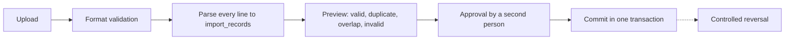

# Integrations and Imports

**All integrations are read-only.** Every connector implements only read operations, and its service account is read-only too, so a code bug still can't change anything.

## Shared rules

- Credentials are encrypted in `integration_connections` and never returned by the API.
- TLS validation is on. Private CAs are added to the trust store rather than verification being disabled.
- Base URLs pass SSRF checks: see [security.md](security.md).
- Connectors use timeouts, pagination, rate limits and bounded retries.
- Each sync records status, counts, errors, last success and connection health.
- External objects link through `external_resource_mappings`, keyed by `(connection, resource type, external ID)`, which stops duplicates when sources report the same object.
- Sync output is evidence. It never overwrites approved ownership or allocation data.

## What has been checked

**No connector has run against a real system yet.** FortiGate, AWS and Azure are tested against fixtures built from published API shapes, because there are no recordings. vCenter is tested against VMware's simulator. Expect some differences on first contact, and record real responses as fixtures once you have them.

Each VDOM, VPC or VNet a sync finds is a context, and a person maps it to a routing domain on the Integrations screen. Connectors never guess this. Until it is mapped, evidence is kept with no routing domain and isn't matched to inventory.

## FortiGate

FortiOS REST API with a read-only API profile. Supports multiple devices and HA.

- **Collects:** firewall inventory, VDOMs, interfaces, primary and secondary IPs, VLAN interfaces, status, descriptions and aliases, address objects and groups, static routes, ARP, DHCP scopes and relevant leases.
- **Context:** every record keeps its VDOM and routing context.
- **HA:** cluster members map to one logical device, so interfaces are not duplicated per member.

## VMware vCenter

`govmomi` with a read-only role. Supports multiple vCenters.

- **Collects:** datacentres, clusters, ESXi hosts, VMs, identifiers, power state, guest IPs, vNICs, MACs, port groups, distributed switches, VLANs.
- **Identity:** VMs are keyed by vCenter instance plus VM identifier.
- **Stale data:** guest IPs on powered-off VMs, or from stale VMware Tools, are marked as lower confidence and never treated as active.

## AWS

AWS SDK v2 using `sts:AssumeRole` into each account with short-lived credentials and an external ID. Read-only policy (`Describe*`-style actions only).

- **Collects:** accounts, regions, VPCs, subnets, route tables, ENIs, private IPv4, IPv6, EC2, Elastic IPs, load balancers, EKS-related interfaces.
- **Context:** account, region, VPC, subnet and resource.
- **Routing:** each VPC maps to a routing domain.
- **No scanning:** cloud inventory comes from APIs only, and active scans of cloud networks are not used.
- **Reserved addresses:** 5 per subnet (first four and last) are counted in utilisation.

## Microsoft Azure

Azure SDK with a workload identity or approved service principal, using the Reader role at the narrowest practical scope.

- **Collects:** tenants, subscriptions, resource groups, VNets, subnets, NICs, private IP configurations, public IPs, VMs, load balancers, application gateways, VNet peering, reserved addresses.
- **Context:** tenant, subscription, resource group, VNet and subnet.
- **Onboarding:** tenants are onboarded one at a time. Access is scoped to the subscription or resource group, and broad tenant-wide permissions are not needed.
- **Routing:** each VNet maps to a routing domain. Peering is recorded but does not merge domains.
- **Reserved addresses:** 5 per subnet (first four and last) are counted in utilisation.

## DNS and DHCP

Read-only. DF-IPAM never changes DNS or DHCP.

- **DNS:** lookups against approved resolvers, plus zone data if the server allows read-only access.
- **DHCP:** FortiGate scopes and leases come through the FortiGate connector. Other servers need a connector once their type is confirmed (see [requirements.md](requirements.md), open item 8).
- **Storage:** results go to `dns_records`, `dhcp_scopes` and `dhcp_reservations`, with raw evidence kept as observations.

## Template import

People load their own data from a template, so nothing has to be typed in by hand. `GET /imports/templates/workbook` gives one Excel file with a sheet per type, and `GET /imports/templates/:key` gives one type as CSV.

The 17 types are organisations, routing domains, business units, sites, network zones, business services, applications, teams, devices, VDOMs, VLANs, interfaces, network blocks, subnets, IP addresses, reserved ranges and DHCP scopes. Users, roles and discovery settings aren't imported, because they grant access or start traffic.

- Sheets run parents first, and rows refer to each other by name or code, in the inventory or on an earlier sheet. A name used twice must be written with its parent, such as `DF/Default`.
- Rows starting with `#` are skipped, which is how the example row works. Unknown or missing columns refuse the whole file.
- An import only adds. A row that already exists is marked duplicate and skipped, never changed.
- Every row is checked on upload and again on approval, since the inventory may have changed. Someone other than the uploader approves, and if any row fails then, nothing is imported.
- A file that sets `allocation_state` needs an approver who may allocate or reserve addresses.
- Rows are fixed in the file: discard the batch and upload again. A discarded or reversed file can be uploaded again.
- Reversal removes everything the import made, children first. It stops if a record is in use, or an imported address has changed.
- Files are limited to 5 MB and 10,000 rows.

## Production file import

Formats: `Prod_Subnets.txt` and `Prod_VDOMs_Subnets.txt`.

> **Not yet validated.** The real files have not been provided, so the parser can't be finalised. Their exact format is unknown.

**Extracts:** the network (CIDR, or address and mask), gateway, VDOM, VLAN and name, where present. A committed line becomes a subnet.

**Rules:**

- Every source line is stored in `import_records` with its status and raw text. Invalid records are never silently dropped.
- Missing VDOM, VLAN, site, business service or owner data stays empty, and is never guessed. These records appear in an enrichment queue for manual completion.
- Imports are idempotent: the same file (matched by hash) can't create records twice while it is imported or waiting for approval.
- Reversal removes only what that batch created and is blocked for records changed since.
- The real production files haven't been received, so the parser is tolerant: it finds the network on each line however it is written. Check the first real upload line by line.
