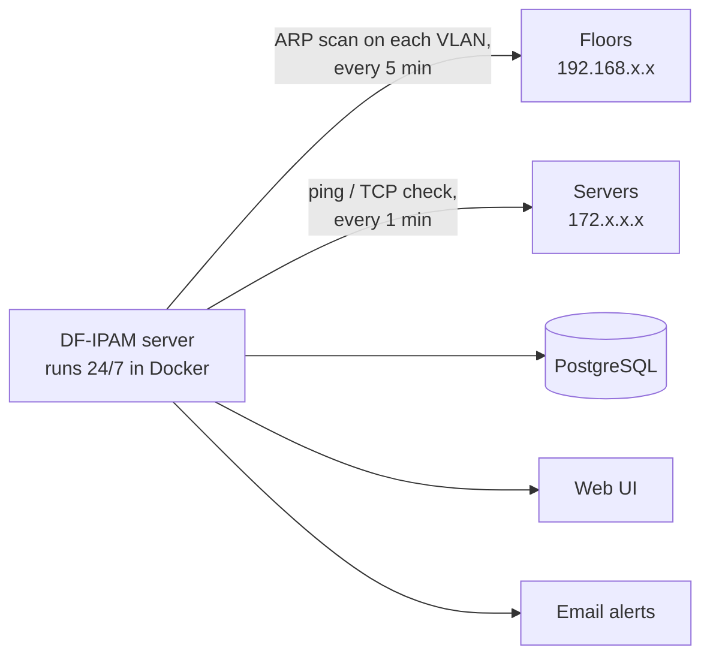

# DF-IPAM Lite: the simpler plan

**Status:** building on branch `lite`. **Steps 1–7 are done**, with an optional read-only FortiGate source (see Progress below). On this branch this file overrides the enterprise design in the other docs. Confirm the network questions at the end before enabling discovery on real segments.

**Branch:** `lite`, created on 2026-11-11 from `refactor/optimise-secure-document` at commit `70c583a`. All Lite work happens here. `main` and the old branch stay untouched until Lite is proven and merged.

## Why change

Today DF-IPAM is built for a multi-site bank with clouds and VRFs: 72 tables, 18 backend modules, about 260 Go files, 20 screens, discovery agents, approval workflows, routing domains, IPv6, AWS, Azure and vCenter.

**What DF-IPAM Lite is:** a place to scan the network and know what is what. It watches, records and reports. It never changes the network: it does not configure DHCP, set IPs on machines, block devices or touch the firewall. When an IP is assigned in DF-IPAM, that is the official record, and an engineer sets the IP on the machine themselves.

What Dialog Finance actually needs is much smaller:

| Need | Reality |
| --- | --- |
| One building, 7 floors | Each floor has one user segment in `192.168.x.x`, served by DHCP |
| Users on DHCP | Some users still set a static IP by hand |
| Server segments | `172.x.x.x`, static IPs only, split by environment: Production, UAT and others. Must be tracked and watched |
| Cloud segments | Networks hosted in a cloud: static like servers, never ping-swept from the building |
| Auto-discovery | Must spot unknown or unauthorised devices |
| No agents on PCs | No PC runs 24 hours, so nothing is installed on user machines |
| Firewall | The FortiGate can be connected **read-only** (optional, off by default): ARP, DHCP leases and VPN sessions |
| IPv4 only | No IPv6 anywhere |

> **Check the server range.** `172.168.x.x` is a public internet range, not a private one. Private is `172.16.0.0` to `172.31.255.255`. If the servers really use `172.168.x.x`, traffic to some real internet sites can be misrouted. Use the exact range when setting up segments.

## The idea in one picture



**No agents and no firewall.** The DF-IPAM server is the only thing that runs all the time, and it does all discovery itself.

To catch unknown devices, the system needs each device's **MAC address**, and a MAC address is only visible from inside the same VLAN. A plain ping from another network only proves an IP is alive. So the server has to "stand" on every floor's VLAN. There are three ways, best first:

| Option | How | Gives MAC? | Needs |
| --- | --- | --- | --- |
| **A. Trunk port (recommended)** | Connect the DF-IPAM server to a switch trunk port carrying all floor VLANs. Linux adds one virtual interface per VLAN, with no IP routing between them. The server ARP-scans each floor directly | Yes, for every device, static or DHCP, even with Windows firewall on | One switch port configured by the network team. No cost |
| **B. Switch SNMP** | Read the core switch's ARP and MAC tables over SNMP, read-only, every 5 minutes. A few kilobytes per poll | Yes, plus the switch port the device is on | SNMP read-only community or v3 user on the core switch |
| **C. Ping and names only** | Ping sweep each floor from the server, then ask each live IP for its name (reverse DNS, and NetBIOS, which also returns the MAC for many Windows PCs) | Partly. Missing for phones, printers and PCs with firewall on | Nothing. Works today |

Start with **C** so something works on day one, and move to **A** when the network team gives a trunk port. All three can feed the same tables, so nothing is rebuilt when switching.

ARP scanning a VLAN is light: one small packet per address, at a gentle rate. A /24 takes a few seconds and does not flood the network.

## What the system does

### 1. Floors (DHCP segments)

- One row per floor: name, VLAN, network (for example `192.168.4.0/24`), gateway, DHCP pool start and end.
- A floor page lists every address seen: IP, MAC, vendor (from the MAC prefix), hostname, DHCP or static, first seen, last seen, owner if known.
- Usage bar: addresses in use against pool size.

### 2. IP register (manual marking and assignment)

Every segment has an IP register: the list of addresses people have marked by hand. Discovery fills the "seen" side, people fill the "assigned" side, and the two are always shown as separate badges.

**Mark an IP.** Click any address on a floor or server page and set:

| Field | Example |
| --- | --- |
| Status | `Assigned`, `Reserved` (kept for later), `Blocked` (never use) |
| Type | Server, printer, network device, CCTV, access point, user PC, other |
| Assigned to | A device from the Devices list, or a free-text name ("HR printer, 3rd floor") |
| Owner / department | Who is responsible |
| Monitor | Check it every minute (on for servers, optional for others) |
| Environment | Production, UAT, Development, DR, Test (servers; see below) |
| Critical | Down or MAC change raises a Critical alert |
| Notes | Anything else |

**Ways to assign:**

- **From discovery:** an address seen on the network but not in the register shows an **Add to register** button. It opens the form pre-filled with the IP, MAC and hostname seen, and a person confirms. Approving an unknown device can register its IP in the same step.
- **By hand for a new server or device:** pick the segment, and the form suggests the next **Available candidate**: an address that is not in the register, not reserved, outside the DHCP pool, and not seen on the network recently. The person can accept it or type another. The system rejects an IP already in the register and warns if the IP was seen in use.
- **Reserve a block:** mark a range (for example `.200`–`.220`) as Reserved for a project in one step.
- **Release:** set an assigned IP back to unassigned. Asks for confirmation and is audited.

Nothing in the register is ever changed by discovery. A scan only adds evidence and raises alerts; people decide.

### 3. Servers (monitored register entries)

- The Servers page is the IP register filtered to server segments, plus anything marked Monitor.
- **Environments.** Every server has an environment: **Production**, **UAT**, **Development**, **DR** or **Test**. Admins can add more (for example "Staging") in Settings. Each environment has a colour badge and a default severity:

  | Environment | Default when down or MAC changes | New server default |
  | --- | --- | --- |
  | Production | **Critical** | Monitor on, critical on |
  | DR | **Critical** | Monitor on, critical on |
  | UAT | High | Monitor on |
  | Development, Test | Medium | Monitor off |

  A single server can still be marked critical or not by hand.
- A server segment can carry a default environment (for example `172.16.10.0/24` = Production, `172.16.20.0/24` = UAT), so new entries in it start with the right one. Mixed segments are fine: the environment is set per IP.
- The Servers page filters by environment, and the dashboard shows servers down per environment.
- Monitored IPs are checked every minute by ping, or a TCP port when ping is blocked (for example 443 or 3389).
- Status shown as **Up / Down / Unknown**, with last change time.
- Alerts if a critical server goes down, or if its IP answers with a **different MAC** than the one registered (conflict or spoofing).

### 4. Devices (known MAC addresses)

- The list of approved devices: MAC, name, owner, department, type (PC, laptop, printer, phone, AP, server).
- New devices land in **Pending** until someone approves or rejects them. Approving can also register the device's IP (see the IP register).
- Bulk import from CSV so the first load is not done by hand.

### 5. Detection rules

Without the DHCP server's lease list, the system tells DHCP from static by the pool range: an address **outside** the floor's DHCP pool must be static.

| Alert | Rule | Severity |
| --- | --- | --- |
| Unknown device | A MAC is seen that is not in Devices | Medium on floors, **High** in server segments |
| Unregistered static IP | An address outside the DHCP pool is in use and not in the IP register | Medium |
| Registered IP misused | An IP marked Reserved or Blocked is seen in use, or an Assigned IP is used by a different MAC | High |
| Unknown server IP | An IP in a server segment answers but is not in the IP register | High (Critical in a Production segment) |
| IP conflict | One IP seen with two MACs within a short time | High |
| Server down | A monitored server fails 3 checks in a row | From its environment: Production and DR **Critical**, UAT High, others Medium |
| Server MAC changed | A server IP answers with a MAC that is not its registered one | From its environment, as above |
| Rejected device back | A rejected MAC appears again | High |

Rules that need a MAC only run when option A or B is in place, or when NetBIOS returned one.

Each alert can be acknowledged, and closes itself when the cause is gone. Email goes out for High and Critical. People decide what to do: the system only reports, it never blocks a device or changes DHCP.

**Caveat:** phones and Windows 11 laptops on Wi-Fi often use random MAC addresses. The system marks these ("private MAC") so they don't flood the unknown list. The real fix is turning random MACs off on the corporate SSID.

### 6. Users and audit

- Three roles: **Admin** (changes the register, approves requests, manages settings), **Requester** (reads, raises IP requests and reservations) and **Viewer** (read only).
- Every change is written to the audit log in the same transaction: who, what, when, before and after. The audit screen filters by user, date, IP and action, and exports to CSV. Kept from today's code.
- Sign-in stays as it is today (Supabase), and moves to company SSO later as in [plan.md](plan.md).

### 7. IP requests (kept, simplified)

For when someone outside the network team needs an IP, for example a new server or printer.

1. A Requester raises a request: segment, type, name, purpose, needed by date, and optionally a specific IP.
2. An Admin sees it in the request queue. The form suggests an **Available candidate** IP.
3. The Admin approves (with the chosen IP) or rejects (with a reason). One approval step, no multi-level chains.
4. On approval the IP register entry is created in the same transaction, and the requester is notified with the IP to use.

States: `pending`, `approved`, `rejected`, `cancelled`. Kept from today's allocation module, without the multi-step workflows and scoped approvers.

### 8. Reservations (kept, simplified)

Hold an IP or a small range for a purpose without assigning it yet, for example "`.200`–`.220` for the new branch printers".

- Reason, owner and an optional **expiry date**. A reservation is shown in the IP register with status Reserved.
- A notification goes out 7 days before expiry. On expiry it is **not** released automatically: the owner or an Admin extends it, turns it into an assignment, or releases it.
- A reserved IP seen in use on the network raises the "Registered IP misused" alert.

### 9. Notifications (kept)

- In-app bell plus email.
- Sent for: High and Critical alerts, new requests (to Admins), request approved or rejected (to the requester), reservations about to expire (to the owner), servers down and back up.
- Each user can switch email off per type. Kept from today's notifications module and its email outbox, so a mail failure never loses a change.

### 10. Reports (kept)

Downloaded as CSV or PDF, on demand:

| Report | Shows |
| --- | --- |
| Segment usage | Per floor and server segment: assigned, reserved, seen in use, pool usage |
| Servers by environment | Count, list and status of servers per environment (Production, UAT, ...) |
| IP register | Every registered IP with type, owner and status |
| Unknown and pending devices | Devices seen but not approved, with first and last seen |
| Static IPs on floors | Hand-set IPs in the DHCP segments, registered or not |
| Server availability | Up time and outages per monitored IP over a date range, filterable by environment |
| Alert history | Alerts raised, acknowledged and closed over a date range |
| Requests and reservations | Open, approved, rejected and expiring |
| Audit log | Changes over a date range |

Kept from today's reports module, including the PDF renderer, with the report list replaced by the ones above.

## What we remove

| Removed | Why |
| --- | --- |
| Discovery agents, policies, jobs, emergency stop, scopes | Replaced by one built-in scanner on the server |
| Routing domains / VRFs | One building, one routing table |
| IPv6, `math/big` and `numeric(39,0)` | IPv4 only. Addresses are plain `inet` in SQL and counts are plain numbers |
| AWS, Azure, vCenter connectors | Not used. The FortiGate came back as an optional, read-only evidence source (see Progress) |
| Reconciliation engine and findings | Replaced by the alert rules above |
| Multi-step approval workflows, scoped approvers, change requests | One approval step is enough (requests and reservations themselves stay) |
| Organisations, business services, scoped roles, custom permissions | Three fixed roles are enough |
| Imports pipeline, retention jobs, background report jobs | One CSV import for devices and the IP register. Reports run on demand |
| Separate `worker` container | The scanner runs inside the backend |

## Data model (13 tables instead of 72)

| Table | Holds |
| --- | --- |
| `users` | Email, name, role (`admin` / `requester` / `viewer`) |
| `segments` | Name, floor, type (`dhcp` / `server`), VLAN, CIDR, gateway, DHCP pool start and end, default environment (server segments), scan interface |
| `environments` | Name (Production, UAT, Development, DR, Test, ...), colour, sort order, default severity, default monitor and critical flags |
| `devices` | MAC, name, owner, department, type, status (`pending` / `approved` / `rejected`) |
| `ip_addresses` | The IP register: IP (unique), segment, status (`assigned` / `reserved` / `blocked`), type, environment, device or free-text name, expected MAC, owner, department, monitor and critical flags, check port, current up/down status, notes |
| `reservations` | IP or range, segment, reason, owner, expiry, status (`active` / `converted` / `released`) |
| `ip_requests` | Requester, segment, type, name, purpose, needed by, requested IP, status, decided by, decision reason, assigned IP |
| `sightings` | One row per IP + MAC: segment, source (ARP / ping / NetBIOS / SNMP), hostname, DHCP or static, first seen, last seen |
| `alerts` | Type, severity, IP, MAC, segment, message, status (`open` / `acknowledged` / `closed`), times |
| `notifications` | Per user: type, message, link, read flag, email sent flag (also the email outbox) |
| `notification_preferences` | Per user and type: email on or off |
| `settings` | Scan intervals, alert email list, SNMP credentials if option B (encrypted) |
| `audit_logs` | Append-only change history |

`sightings` is updated in place (upsert), so it stays small: about as many rows as devices in the building.

## Screens (9 instead of 20)

0. **Discovery:** everything the scanner and firewall have seen, filtered and paged, with scan status and Scan now. Each segment has an address page with a map of every address.
1. **Dashboard:** floor DHCP usage summaries, open alerts by severity, servers down per environment.
2. **Servers:** server register with live status, filtered by environment. Add a server with a suggested Available candidate IP.
3. **Devices:** approved, pending and rejected, with approve / reject buttons.
4. **Alerts:** open and recent alerts, acknowledge, and manage email preferences.
5. **Requests:** raise a request, and for Admins the approval queue.
6. **Reservations:** active and expiring holds, extend, convert or release.
7. **Reports:** pick a report and date range, download CSV or PDF.
8. **Settings:** segments, environments, users and audit log.

The notification bell sits in the top bar on every screen.

Same blue light theme, same `Modal`, same loading / empty / error states.

## How discovery works, step by step

Every 5 minutes, inside the backend, for each segment:

1. Scan it: ARP scan (option A), SNMP read (option B), or ping sweep plus name lookup (option C).
2. Upsert each IP and MAC into `sightings`. Mark it static if it is outside the DHCP pool.
3. Run the detection rules, opening and closing alerts.

Every 1 minute: check each IP marked Monitor.

The scanner needs the `NET_RAW` capability in its container for ping and ARP, and for option A it runs with host networking so it can see the VLAN interfaces.

## Build plan

Start a fresh, small codebase on a new branch rather than stripping the old one table by table. Reuse what is good.

| Step | Work | Reuse |
| --- | --- | --- |
| 1 | **Done.** Branch `lite`. New migration set (13 tables, RLS and grants as today). Old modules, agent and worker removed. Containers: `db`, `backend`, `web` | Auth (`internal/auth`), `platform`, `netcalc`, Docker setup |
| 2 | **Done.** Segment and IP register APIs, device CRUD and CSV import / export, Available candidate and range reservation; basic segment, server and device screens. Mutations write audit records in the same transaction | Route guard, error format, audit writer, `netcalc` |
| 3 | **Done.** Built-in option C scanner: bounded ping sweeps, reverse DNS, NetBIOS name / MAC lookup, and monitored IP health checks | ICMP approach from `internal/agent/ping.go` (from `70c583a`) |
| 4 | **Done.** Alert rules, alert screen, notification bell, email outbox and preferences | `internal/platform/mail` |
| 5 | **Done.** One-step IP requests and reservations, expiry reminders, release and conversion | `netcalc`, audit writer |
| 6 | **Done.** Reports (CSV, Excel and PDF) and the audit screen | `internal/modules/reports` and its PDF renderer, `internal/modules/auditlog`, `web/src/features/{requests,reservations,reports,audit}` |
| 7 | **Done.** Dashboard with floor DHCP usage, alert counts and servers down by environment. No separate Floors page | UI components, theme |
| 8 | Scanner option A (ARP scan per VLAN) once the trunk port is ready, or option B | |
| 9 | Load real data, run a week alongside the network team, tune noise, then retire the old code | |

Code marked "from `70c583a`" was removed in step 1 and is still in git history. Bring a file back with `git show 70c583a:api/<path>` and trim it to the new schema. Once Lite is live, rewrite `CLAUDE.md`, `docs/README.md` and `docs/development_phase.md`. The rules about routing domains, IPv6 and the FortiGate go; the rules about audit, secrets, read-only network access and "discovery never changes ownership" stay.

## Progress

### Step 1: foundation (done, 2026-11-11)

**Database.** The 15 old migrations are replaced by one, `api/migrations/000001_lite.up.sql`, with the 13 tables above. Every table has row level security, the `dfipam_app_all` policy and explicit grants. The schema itself enforces:

- IPv4 only, and segment networks never overlap.
- A DHCP pool sits inside its network, and only floor segments have one.
- Register IPs and reservations sit inside their segment, and a segment can't be moved away from them.
- One IP appears once in the register.
- A rejected request needs a reason, and a decided request needs who decided and when.
- Only one open alert per cause.
- The audit log is append-only. Users, requests and reservations can't be deleted by the app.

`make test-db` checks all of these against a throwaway `dfipam_test` database.

**Backend at the end of Step 1.** Sign-in, `/auth/me` and `/auth/me/profile` remained. Roles are fixed in code (`api/internal/auth/permissions.go`) and stored in `users.role`. The seed loads the 5 environments and default settings. The AWS, Azure, vCenter and spreadsheet libraries are gone.

**Web at the end of Step 1.** The menu had the Lite screens, each saying "Not built yet" without sample data.

**Docker.** `db`, `migrate` (runs once), `backend` and `web`. The plan said two containers, but `web` stays: it is Nginx, the only public entry, with TLS and rate limits. The agent container, worker and retention timers are gone.

**Switching an existing database.** A database made by the old migrations can't be upgraded in place. Docker uses a separate `df-ipam-lite-db-data` volume for Lite and leaves the previous `df-ipam_db-data` volume untouched.

**First Admin.** Sign in once, then in `make db-shell`:

```sql
UPDATE users SET role = 'admin' WHERE lower(email) = lower('<your email>');
```

Other roles are `requester` and `viewer`. Admins will manage roles in Settings from step 2.

### Step 2: inventory and register (done, 2026-11-11)

Added guarded segment CRUD; device CRUD, approval / rejection, and CSV import / export; IP register create, update and release; range reservations; and Available candidate lookup. Mutations write audit records in the same database transaction. The web app now has live segment, server-register and device lists with basic create, device decision and CSV controls. More detailed edit forms remain part of screen polish as the related workflows land.

### Step 3: scanner (done, 2026-11-11)

The backend starts two cancellable background loops. Discovery runs immediately and then every `scan.interval_minutes` (default 10 since step 6): it pings IPv4 hosts in each segment, records responsive addresses in `sightings`, looks up reverse DNS, and queries NetBIOS for a hostname and MAC when available. DHCP pool membership determines the `is_static` evidence flag; discovery does not write the IP register or assign ownership. A segment with more than 4,096 usable addresses is skipped with a logged error, so large ranges must be split before scanning.

Monitored register entries are checked immediately and every `server_check.interval_seconds` (default 86400, once a day, since step 6). ICMP is tried first and the configured TCP port is used when ICMP does not answer. The scanner updates `health`, `health_changed_at` and the consecutive failure counter. Alerts and notifications for health transitions are Step 4. The backend container has `NET_RAW` for ICMP; all network operations are read-only.

Option C cannot reliably discover MAC addresses across routed networks: NetBIOS supplies them only for hosts that answer the query. Phones, printers, and devices that block ICMP or NetBIOS may not appear. Option A or B is still needed for dependable MAC-level inventory.

### Step 4: alerts and notifications (done, 2026-11-11)

The monitoring engine evaluates recent sightings and health checks, deduplicates open alert causes, and closes alerts when their cause disappears. It covers unknown and rejected devices, unregistered static and server IPs, register misuse, IP conflicts, server MAC changes and server downtime after the configured consecutive failure count. Production server alerts use the environment severity. Unknown MACs create pending device records for review.

The Alerts screen supports severity ordering and acknowledgement. The notification bell shows each user's inbox and unread count; users can mark one or all read and change email preferences by notification type. High and Critical alerts and request decisions use the SMTP outbox. Reservation expiry reminders are queued once during the seven days before expiry; nothing is released automatically. With SMTP unset, in-app notifications remain and email queue entries are cleared.

### Step 5: requests and reservations (done, 2026-11-11)

Requesters can submit, view and cancel their own pending IP requests. Admins approve with a selected or suggested Available candidate IP, or reject with a required reason. Approval creates the register row and decides the request in one transaction, with audit rows and requester notifications.

Reservations support an IP or range, optional owner and expiry, extension, release and conversion of a chosen address into an assignment. Converting part of a range keeps the remaining addresses held by splitting the active range. A reservation overlapping a registered, recently seen or already reserved address is rejected. Owners and Admins may manage their holds.

### Step 7: dashboard (done, 2026-11-11)

The Dashboard shows DHCP pool use and registered / seen counts per floor segment, open alerts by severity, and monitored servers down by environment. There is no separate Floors screen; detailed floor address browsing is omitted from this Lite build.

### Step 6, Discovery screen and hardening (done, 2026-11-11)

**Discovery and segments.** A Discovery screen lists every sighting across segments with filters (segment, online or not answering, not in the register, static, unknown or rejected device, private MAC, DHCP lease, VPN, has alerts; source; seen within 1 h to all; search) and shows first discovered, last seen and "unavailable since". Admins can start a scan of all segments or one; the server refuses while a scan runs and spaces manual scans a minute apart. Scan results per segment are kept in memory. Each segment has a page with an address map (every usable address of a /20 or smaller, coloured by state: assigned, reserved, blocked, held, gateway, seen-unregistered, DHCP in use, DHCP free, Available candidate) and a paged address list with Add to register.

**Cloud segments.** A third segment type, `cloud`, behaves like a server segment (static, default environment, server alert rules) but is never ping-swept. Migration 000005.

**FortiGate (optional, read-only).** Settings > FortiGate stores the address, VDOM, TLS verification, read interval and a REST API token encrypted with `SECRET_ENCRYPTION_KEY`; the token is never returned or logged. DF-IPAM sends only GET requests and reads the ARP table, DHCP leases (hostname, MAC and the DHCP vendor class, which hints at the OS) and SSL and IPsec VPN sessions. ARP and DHCP evidence is kept only inside known segments; VPN clients are recorded with source `vpn`. Nothing is sniffed and no device is logged in to. Off by default; "Test connection" and "Read now" work before the schedule is switched on.

**Reports and audit.** Nine on-demand reports in CSV, Excel and PDF (PDF up to 5,000 rows; the others 200,000; a cut-off file says so). Server availability is derived from Server down alerts. The audit screen filters by user, action, record type, dates and free text (IP, MAC, name, record ID) and exports CSV or Excel.

**Excel everywhere.** Devices, the IP register, the audit log and reports export as `.xlsx` or CSV. Device and register imports accept `.csv` or `.xlsx` (5 MB, 5,000 rows), insert all valid rows in one statement and report each skipped row. Spreadsheet formulas in imported or exported text are neutralised.

**Settings.** Users and roles (never your own; never the last Admin), environments, segments, and System: discovery interval (default **10 minutes**), server check interval (default **once a day**), failed checks before Down, reservation reminder days, the **email switch (off by default)** and the **idle session timeout** (default 30 minutes, warning one minute before, activity in any tab counts).

**Flood protection.** Alerts that close and reopen within an hour reopen quietly; more than five new High or Critical alerts in one evaluation become one summary notification; at most 20 emails an hour per person (the rest stay in-app); read notifications older than 90 days are removed; private MACs never create pending devices or unknown-device alerts; a requester can have at most 20 pending requests; reservations are at most 256 addresses; manual scans and FortiGate reads are a minute apart; searches are debounced and lists paged (25 by default, 200 at most).

**Platforms and services.** Devices and register entries record a platform (Windows, macOS, iOS, Android, Linux and its distributions, VMware, network and printer brands, and others), and servers record their main services (Apache, Nginx, Tomcat, IIS, Docker, databases, DNS, DHCP and so on). Both are set by people (migration 000006). When none is recorded, the screens suggest a likely platform from the DHCP vendor class and hostname, shown faded and labelled "likely". Brand marks come from Simple Icons (CC0). Simple Icons carries no Microsoft marks, so Windows is drawn as a plain four-pane window.

**Fixes.** `inet::text` returns `/32`, which broke address parsing: server checks never pinged (every monitored server would go Down), DHCP pool detection and the Available candidate ignored used addresses. All inet output now uses `host()`. A server is Down only after the configured number of failed checks. The Available candidate skips the gateway and the DHCP pool. Notifications returned Go field names, so the bell showed blank items. Missing records now answer 404, not 500.

**Tests.** `make test-db` drives every API route against a throwaway database as the app role (lists, write flows, imports and exports, all reports in three formats, the address map) and drops the database afterwards. The FortiGate reader is tested against a fake firewall.

**Databases.** Lite uses only the `df-ipam-lite-db-data` volume. The previous enterprise volume `df-ipam_db-data` was backed up to `../df-ipam-backups/df-ipam-enterprise-volume-2026-11-11.sql.gz` (with `SHA256SUMS`) and removed. Restore with `zcat <file> | psql -U postgres` into an empty PostgreSQL 16.

## Questions to answer first

| # | Question | Why |
| --- | --- | --- |
| 1 | The exact list of segments: floor, VLAN, CIDR, DHCP pool range, and for server segments which environment each is (Production, UAT, ...) | Initial setup, and static detection depends on the pool range |
| 2 | Is the server range really `172.168.x.x`, or `172.16`–`172.31`? | See the warning at the top |
| 3 | Can the network team give the DF-IPAM server a trunk port with all floor VLANs (option A)? If not, SNMP read-only on the core switch (option B)? | Decides whether MAC-based detection is possible |
| 4 | Which device serves DHCP to the floors (core switch, Windows server, other)? | A read-only lease list would make static detection exact, not only by pool range |
| 5 | Can the DF-IPAM server ping every floor and the server segment? | Needed for option C and server checks |
| 6 | Is Wi-Fi on the same floor segments, or separate? Guest Wi-Fi? | Guest Wi-Fi should be excluded from unknown-device alerts |
| 7 | Who receives alert emails, and who approves IP requests? | Alert routing and the Admin list |
| 8 | Is there an existing device list (asset register, AD computers) to import? | Avoids hundreds of "unknown" alerts on day one |
