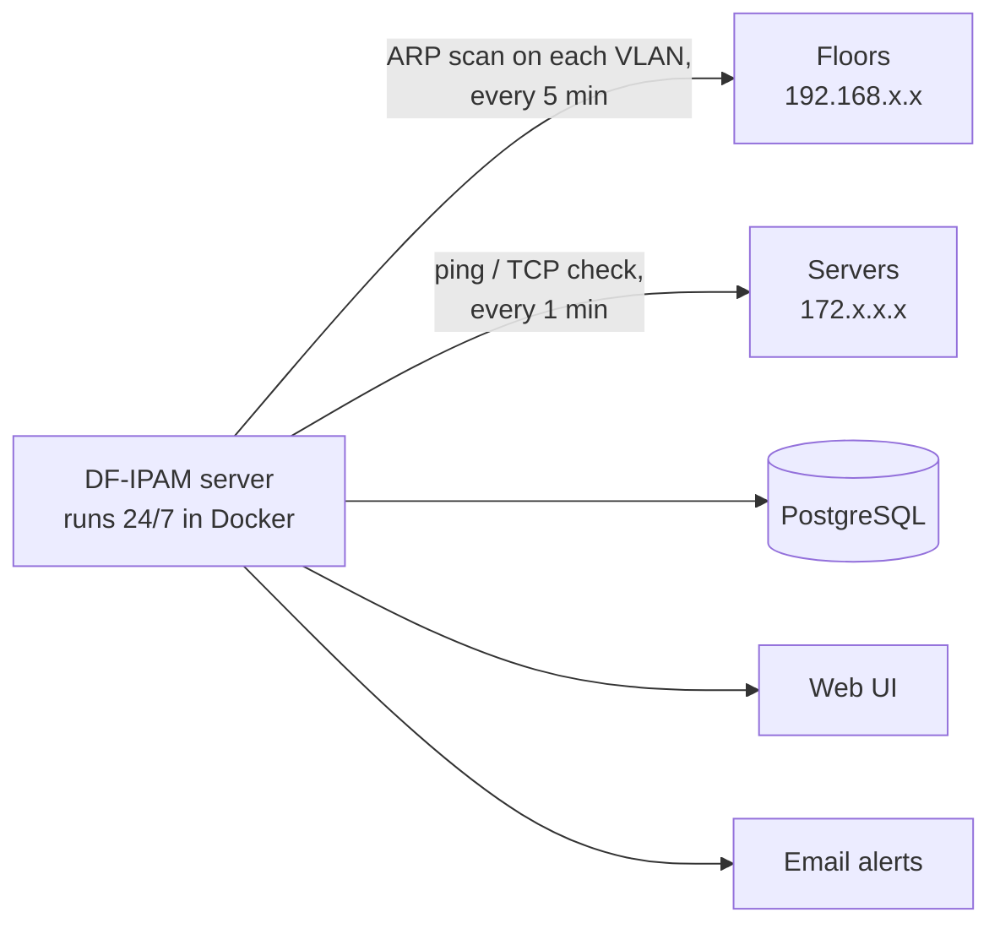

# DF-IPAM Lite: the simpler plan

**Status:** plan approved, building on branch `lite`. Nothing in the code has changed yet. It replaces the enterprise design in the other docs once Lite is live. Answer the questions at the end before step 3 (the scanner).

**Branch:** `lite`, created on 2026-11-11 from `refactor/optimise-secure-document` at commit `70c583a`. All Lite work happens here. `main` and the old branch stay untouched until Lite is proven and merged.

## Why change

Today DF-IPAM is built for a multi-site bank with clouds and VRFs: 72 tables, 18 backend modules, about 260 Go files, 20 screens, discovery agents, approval workflows, routing domains, IPv6, AWS, Azure and vCenter.

**What DF-IPAM Lite is:** a place to scan the network and know what is what. It watches, records and reports. It never changes the network: it does not configure DHCP, set IPs on machines, block devices or touch the firewall. When an IP is assigned in DF-IPAM, that is the official record, and an engineer sets the IP on the machine themselves.

What Dialog Finance actually needs is much smaller:

| Need | Reality |
| --- | --- |
| One building, 7 floors | Each floor has one user segment in `192.168.x.x`, served by DHCP |
| Users on DHCP | Some users still set a static IP by hand |
| A server segment | `172.x.x.x`, static IPs only. Critical, must be tracked and watched |
| Auto-discovery | Must spot unknown or unauthorised devices |
| No agents on PCs | No PC runs 24 hours, so nothing is installed on user machines |
| No firewall access | The FortiGate is not connected to DF-IPAM for now |
| IPv4 only | No IPv6 anywhere |

> **Check the server range.** `172.168.x.x` is a public internet range, not a private one. Private is `172.16.0.0` to `172.31.255.255`. If the servers really use `172.168.x.x`, traffic to some real internet sites can be misrouted. Use the exact range when setting up segments.

## The idea in one picture

**No agents and no firewall.** The DF-IPAM server is the only thing that runs all the time, and it does all discovery itself.

To catch unknown devices, the system needs each device's **MAC address**, and a MAC address is only visible from inside the same VLAN. A plain ping from another network only proves an IP is alive. So the server has to "stand" on every floor's VLAN. There are three ways, best first:

| Option | How | Gives MAC? | Needs |
| --- | --- | --- | --- |
| **A. Trunk port (recommended)** | Connect the DF-IPAM server to a switch trunk port carrying all floor VLANs. Linux adds one virtual interface per VLAN, with no IP routing between them. The server ARP-scans each floor directly | Yes, for every device, static or DHCP, even with Windows firewall on | One switch port configured by the network team. No cost |
| **B. Switch SNMP** | Read the core switch's ARP and MAC tables over SNMP, read-only, every 5 minutes. A few kilobytes per poll | Yes, plus the switch port the device is on | SNMP read-only community or v3 user on the core switch |
| **C. Ping and names only** | Ping sweep each floor from the server, then ask each live IP for its name (reverse DNS, and NetBIOS, which also returns the MAC for many Windows PCs) | Partly. Missing for phones, printers and PCs with firewall on | Nothing. Works today |

Start with **C** so something works on day one, and move to **A** when the network team gives a trunk port. All three can feed the same tables, so nothing is rebuilt when switching.

ARP scanning a VLAN is light: one small packet per address, at a gentle rate. A /24 takes a few seconds and does not flood the network.

## What the system does

### 1. Floors (DHCP segments)

- One row per floor: name, VLAN, network (for example `192.168.4.0/24`), gateway, DHCP pool start and end.
- A floor page lists every address seen: IP, MAC, vendor (from the MAC prefix), hostname, DHCP or static, first seen, last seen, owner if known.
- Usage bar: addresses in use against pool size.

### 2. IP register (manual marking and assignment)

Every segment has an IP register: the list of addresses people have marked by hand. Discovery fills the "seen" side, people fill the "assigned" side, and the two are always shown as separate badges.

**Mark an IP.** Click any address on a floor or server page and set:

| Field | Example |
| --- | --- |
| Status | `Assigned`, `Reserved` (kept for later), `Blocked` (never use) |
| Type | Server, printer, network device, CCTV, access point, user PC, other |
| Assigned to | A device from the Devices list, or a free-text name ("HR printer, 3rd floor") |
| Owner / department | Who is responsible |
| Monitor | Check it every minute (on for servers, optional for others) |
| Critical | Down or MAC change raises a Critical alert |
| Notes | Anything else |

**Ways to assign:**

- **From discovery:** an address seen on the network but not in the register shows an **Add to register** button. It opens the form pre-filled with the IP, MAC and hostname seen, and a person confirms. Approving an unknown device can register its IP in the same step.
- **By hand for a new server or device:** pick the segment, and the form suggests the next **Available candidate**: an address that is not in the register, not reserved, outside the DHCP pool, and not seen on the network recently. The person can accept it or type another. The system rejects an IP already in the register and warns if the IP was seen in use.
- **Reserve a block:** mark a range (for example `.200`–`.220`) as Reserved for a project in one step.
- **Release:** set an assigned IP back to unassigned. Asks for confirmation and is audited.

Nothing in the register is ever changed by discovery. A scan only adds evidence and raises alerts; people decide.

### 3. Servers (monitored register entries)

- The Servers page is the IP register filtered to the server segment, plus anything marked Monitor.
- Monitored IPs are checked every minute by ping, or a TCP port when ping is blocked (for example 443 or 3389).
- Status shown as **Up / Down / Unknown**, with last change time.
- Alerts if a critical server goes down, or if its IP answers with a **different MAC** than the one registered (conflict or spoofing).

### 4. Devices (known MAC addresses)

- The list of approved devices: MAC, name, owner, department, type (PC, laptop, printer, phone, AP, server).
- New devices land in **Pending** until someone approves or rejects them. Approving can also register the device's IP (see the IP register).
- Bulk import from CSV so the first load is not done by hand.

### 5. Detection rules

Without the DHCP server's lease list, the system tells DHCP from static by the pool range: an address **outside** the floor's DHCP pool must be static.

| Alert | Rule | Severity |
| --- | --- | --- |
| Unknown device | A MAC is seen that is not in Devices | Medium on floors, **High** in the server segment |
| Unregistered static IP | An address outside the DHCP pool is in use and not in the IP register | Medium |
| Registered IP misused | An IP marked Reserved or Blocked is seen in use, or an Assigned IP is used by a different MAC | High |
| Unknown server IP | An IP in the server segment answers but is not in the IP register | High |
| IP conflict | One IP seen with two MACs within a short time | High |
| Server down | A critical server fails 3 checks in a row | **Critical** |
| Server MAC changed | A server IP answers with a MAC that is not its registered one | **Critical** |
| Rejected device back | A rejected MAC appears again | High |

Rules that need a MAC only run when option A or B is in place, or when NetBIOS returned one.

Each alert can be acknowledged, and closes itself when the cause is gone. Email goes out for High and Critical. People decide what to do: the system only reports, it never blocks a device or changes DHCP.

**Caveat:** phones and Windows 11 laptops on Wi-Fi often use random MAC addresses. The system marks these ("private MAC") so they don't flood the unknown list. The real fix is turning random MACs off on the corporate SSID.

### 6. Users and audit

- Three roles: **Admin** (changes the register, approves requests, manages settings), **Requester** (reads, raises IP requests and reservations) and **Viewer** (read only).
- Every change is written to the audit log in the same transaction: who, what, when, before and after. The audit screen filters by user, date, IP and action, and exports to CSV. Kept from today's code.
- Sign-in stays as it is today (Supabase), and moves to company SSO later as in [plan.md](plan.md).

### 7. IP requests (kept, simplified)

For when someone outside the network team needs an IP, for example a new server or printer.

1. A Requester raises a request: segment, type, name, purpose, needed by date, and optionally a specific IP.
2. An Admin sees it in the request queue. The form suggests an **Available candidate** IP.
3. The Admin approves (with the chosen IP) or rejects (with a reason). One approval step, no multi-level chains.
4. On approval the IP register entry is created in the same transaction, and the requester is notified with the IP to use.

States: `pending`, `approved`, `rejected`, `cancelled`. Kept from today's allocation module, without the multi-step workflows and scoped approvers.

### 8. Reservations (kept, simplified)

Hold an IP or a small range for a purpose without assigning it yet, for example "`.200`–`.220` for the new branch printers".

- Reason, owner and an optional **expiry date**. A reservation is shown in the IP register with status Reserved.
- A notification goes out 7 days before expiry. On expiry it is **not** released automatically: the owner or an Admin extends it, turns it into an assignment, or releases it.
- A reserved IP seen in use on the network raises the "Registered IP misused" alert.

### 9. Notifications (kept)

- In-app bell plus email.
- Sent for: High and Critical alerts, new requests (to Admins), request approved or rejected (to the requester), reservations about to expire (to the owner), servers down and back up.
- Each user can switch email off per type. Kept from today's notifications module and its email outbox, so a mail failure never loses a change.

### 10. Reports (kept)

Downloaded as CSV or PDF, on demand:

| Report | Shows |
| --- | --- |
| Segment usage | Per floor and server segment: assigned, reserved, seen in use, pool usage |
| IP register | Every registered IP with type, owner and status |
| Unknown and pending devices | Devices seen but not approved, with first and last seen |
| Static IPs on floors | Hand-set IPs in the DHCP segments, registered or not |
| Server availability | Up time and outages per monitored IP over a date range |
| Alert history | Alerts raised, acknowledged and closed over a date range |
| Requests and reservations | Open, approved, rejected and expiring |
| Audit log | Changes over a date range |

Kept from today's reports module, including the PDF renderer, with the report list replaced by the ones above.

## What we remove

| Removed | Why |
| --- | --- |
| Discovery agents, policies, jobs, emergency stop, scopes | Replaced by one built-in scanner on the server |
| Routing domains / VRFs | One building, one routing table |
| IPv6, `math/big` and `numeric(39,0)` | IPv4 only. Addresses are plain `inet` in SQL and counts are plain numbers |
| FortiGate, AWS, Azure, vCenter connectors | Not used. FortiGate can come back later if wanted |
| Reconciliation engine and findings | Replaced by the alert rules above |
| Multi-step approval workflows, scoped approvers, change requests | One approval step is enough (requests and reservations themselves stay) |
| Organisations, business services, scoped roles, custom permissions | Three fixed roles are enough |
| Imports pipeline, retention jobs, background report jobs | One CSV import for devices and the IP register. Reports run on demand |
| Separate `worker` container | The scanner runs inside the backend |

## Data model (12 tables instead of 72)

| Table | Holds |
| --- | --- |
| `users` | Email, name, role (`admin` / `requester` / `viewer`) |
| `segments` | Name, floor, type (`dhcp` / `server`), VLAN, CIDR, gateway, DHCP pool start and end, scan interface |
| `devices` | MAC, name, owner, department, type, status (`pending` / `approved` / `rejected`) |
| `ip_addresses` | The IP register: IP (unique), segment, status (`assigned` / `reserved` / `blocked`), type, device or free-text name, expected MAC, owner, department, monitor and critical flags, check port, current up/down status, notes |
| `reservations` | IP or range, segment, reason, owner, expiry, status (`active` / `converted` / `released`) |
| `ip_requests` | Requester, segment, type, name, purpose, needed by, requested IP, status, decided by, decision reason, assigned IP |
| `sightings` | One row per IP + MAC: segment, source (ARP / ping / NetBIOS / SNMP), hostname, DHCP or static, first seen, last seen |
| `alerts` | Type, severity, IP, MAC, segment, message, status (`open` / `acknowledged` / `closed`), times |
| `notifications` | Per user: type, message, link, read flag, email sent flag (also the email outbox) |
| `notification_preferences` | Per user and type: email on or off |
| `settings` | Scan intervals, alert email list, SNMP credentials if option B (encrypted) |
| `audit_log` | Append-only change history |

`sightings` is updated in place (upsert), so it stays small: about as many rows as devices in the building.

## Screens (9 instead of 20)

1. **Dashboard:** floor cards with usage, open alerts by severity, servers down.
2. **Floors:** pick a floor, see every address with its register badge and its seen badge. Mark, assign, reserve or release from here.
3. **Servers:** the server segment's register with live status. Add a server with a suggested Available candidate IP.
4. **Devices:** approved, pending and rejected, with approve / reject buttons.
5. **Alerts:** open and recent, acknowledge.
6. **Requests:** raise a request, and for Admins the approval queue.
7. **Reservations:** active and expiring holds, extend, convert or release.
8. **Reports:** pick a report and date range, download CSV or PDF.
9. **Settings:** segments, users, email, audit log.

The notification bell sits in the top bar on every screen.

Same blue light theme, same `Modal`, same loading / empty / error states.

## How discovery works, step by step

Every 5 minutes, inside the backend, for each segment:

1. Scan it: ARP scan (option A), SNMP read (option B), or ping sweep plus name lookup (option C).
2. Upsert each IP and MAC into `sightings`. Mark it static if it is outside the DHCP pool.
3. Run the detection rules, opening and closing alerts.

Every 1 minute: check each IP marked Monitor.

The scanner needs the `NET_RAW` capability in its container for ping and ARP, and for option A it runs with host networking so it can see the VLAN interfaces.

## Build plan

Start a fresh, small codebase on a new branch rather than stripping the old one table by table. Reuse what is good.

| Step | Work | Reuse |
| --- | --- | --- |
| 1 | Branch `lite` (created). New migration set (12 tables, RLS and grants as today). Two containers: `db` and `app` (Go serves the API and the built web app) | Auth (`internal/auth`), `platform`, `netcalc`, Docker setup |
| 2 | Segments, IP register (mark, assign, reserve range, release, Available candidate), devices: CRUD, CSV import / export, audit | Route guard, error format, audit writer, `netcalc` |
| 3 | Scanner, option C first: ping sweep, reverse DNS, NetBIOS name and MAC, server checks | `agent/ping.go` |
| 4 | Alert rules, alert screen, notifications (bell, email, preferences) | `notifications` module and outbox |
| 5 | Requests and reservations | `allocation` module (requests, reservations, Available candidate), trimmed to one approval step |
| 6 | Reports (CSV and PDF) and the audit screen | `reports` module and PDF renderer, `auditlog` module, `web/src/features/{requests,reservations,reports,audit}` |
| 7 | Dashboard and floor pages | UI components, theme, `Modal` |
| 8 | Scanner option A (ARP scan per VLAN) once the trunk port is ready, or option B | |
| 9 | Load real data, run a week alongside the network team, tune noise, then retire the old code | |

The old code stays in git history. Once Lite is live, delete the unused modules and update `CLAUDE.md`, `docs/README.md` and `docs/development_phase.md`. The rules about routing domains, IPv6 and the FortiGate go; the rules about audit, secrets, read-only network access and "discovery never changes ownership" stay.

## Questions to answer first

| # | Question | Why |
| --- | --- | --- |
| 1 | The exact list of segments: floor, VLAN, CIDR, DHCP pool range | Initial setup, and static detection depends on the pool range |
| 2 | Is the server range really `172.168.x.x`, or `172.16`–`172.31`? | See the warning at the top |
| 3 | Can the network team give the DF-IPAM server a trunk port with all floor VLANs (option A)? If not, SNMP read-only on the core switch (option B)? | Decides whether MAC-based detection is possible |
| 4 | Which device serves DHCP to the floors (core switch, Windows server, other)? | A read-only lease list would make static detection exact, not only by pool range |
| 5 | Can the DF-IPAM server ping every floor and the server segment? | Needed for option C and server checks |
| 6 | Is Wi-Fi on the same floor segments, or separate? Guest Wi-Fi? | Guest Wi-Fi should be excluded from unknown-device alerts |
| 7 | Who receives alert emails, and who approves IP requests? | Alert routing and the Admin list |
| 8 | Is there an existing device list (asset register, AD computers) to import? | Avoids hundreds of "unknown" alerts on day one |
