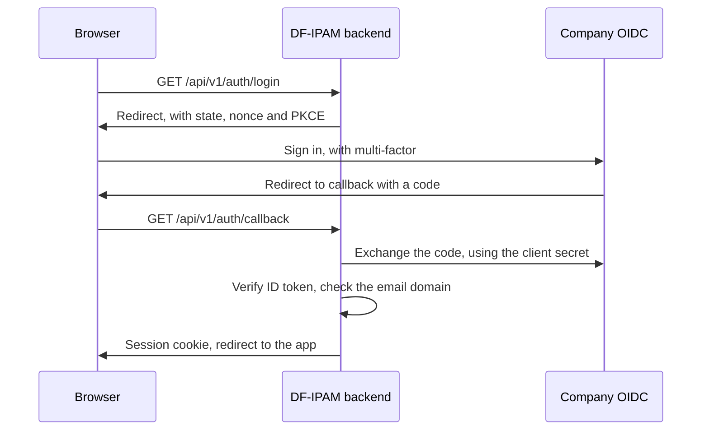

# Plan: company sign-in, no Supabase

**Status:** Phases 1 and 2 are built: Microsoft Entra ID sign-in runs alongside Supabase (see [authentication.md](authentication.md#microsoft-entra-id)), for `@dialogfinance.lk` only. Phases 3 and 4 (moving accounts over, removing Supabase) wait for your go-ahead.

## Goal

| Today | After |
| --- | --- |
| Sign-in through Supabase, with a password | Sign-in through the company's OIDC provider. DF-IPAM holds no passwords |
| Anyone with a Supabase account | Only `@dialogfinance.lk` and `@dialog.lk` |
| Supabase test database, keys and SQL bundle | Gone. PostgreSQL in Docker is the only database |
| Tokens in browser storage | A session cookie JavaScript can't read |

This also closes three open items: no password screen, no multi-factor sign-in, and the `service_role` key.

## Phase 0: Answers needed first

From the identity team:

| # | Question | Why it matters |
| --- | --- | --- |
| 1 | Which product: Entra ID, Keycloak, ADFS, Okta? | Claim names and logout differ |
| 2 | **Do `@dialogfinance.lk` and `@dialog.lk` sign in through the same provider?** | If not, the design needs two issuers |
| 3 | Issuer URL, client ID and client secret | The connection itself |
| 4 | Can it register `https://<host>/api/v1/auth/callback`, and `http://localhost:5173/api/v1/auth/callback` for development? | Sign-in fails otherwise |
| 5 | Which claim holds the work email, and is `email_verified` sent? | The domain rule depends on it |
| 6 | Is multi-factor enforced by the provider? | Strong authentication |
| 7 | Can the server reach the provider, and does it use a private CA? | Firewall and trust store |

From you:

| # | Decision | Recommendation |
| --- | --- | --- |
| 8 | Is everyone at `@dialog.lk` meant to sign in, or only some? | Allow sign-in; they see nothing until given a role |
| 9 | Subdomains such as `@it.dialog.lk`? | No: exact domains only |
| 10 | Session length | 30 minutes idle (as today), 10 hours at most |
| 11 | Delete the Supabase project after cutover? | Yes, after a week of stable sign-ins. It can't be undone |

## Phase 1: Sign-in on the backend

The backend does the sign-in, and the browser only ever holds a cookie.

1. Add `api/internal/auth/oidc.go` with `coreos/go-oidc` and `golang.org/x/oauth2`.
2. Add `GET /auth/login`, `GET /auth/callback` and `POST /auth/logout` outside the authenticated group; list them in the route guard test and `openapi.yaml`.
3. Replace the bearer check in `Authenticate` with a session lookup, behind an interface so tests can stub it. Keep the per-request active-user check.
4. Rate-limit the sign-in routes, and audit `auth.login`, `auth.logout` and `auth.login_denied`.
5. A new migration: a `sessions` table (token hash, user, created, last seen, expires, revoked) with RLS, the `dfipam_app_all` policy and grants; and a unique index on `lower(users.email)`. Expired sessions are removed hourly.

**Domain rule:** `AUTH_ALLOWED_EMAIL_DOMAINS=dialogfinance.lk,dialog.lk`, checked on the server in the callback. Lowercase the email, take the part after the last `@`, require an exact match, and require `email_verified`. Pin the issuer; never a multi-tenant "common" endpoint. **Passing the rule gives no access:** a new person waits for a role. Users are identified by the provider's `sub`, not by email.

**Cookie:** `__Host-dfipam_session`, `Secure`, `HttpOnly`, `SameSite=Lax`, 256 random bits with only a SHA-256 hash stored. Unsafe methods need a matching `Origin` and a custom header. CORS goes, because the app and API share one origin.

## Phase 2: Sign-in in the web app

1. Replace `web/src/lib/auth.ts` with the redirect, sign-out and a session check.
2. One **Sign in with company account** button, and a clear message when a domain is refused.
3. Send cookies and the CSRF header instead of `Authorization` in `web/src/lib/api.ts`.
4. Remove `@supabase/supabase-js`.
5. Add **Add person** in Users and roles: a company email and role before their first sign-in. This removes `supabase_admin.go` and the `service_role` key.

## Phase 3: Existing accounts

At cutover, for each existing user, set `auth_provider = 'oidc'`, the company email, and `auth_subject = 'pending:<email>'`. At first sign-in, a verified email matching a `pending:` row takes over that row once, so roles and history stay. **Run it at cutover, not before,** or Supabase sign-in stops working.

## Phase 4: Remove Supabase

| Area | Change |
| --- | --- |
| Code | Delete `api/internal/auth/supabase*.go` and the Supabase code in `web/src/lib/auth.ts` |
| SQL bundle | Delete `cmd/sqlbundle`, `internal/sqlbundle` and `api/sql/supabase-setup.sql` |
| Config | Remove `SUPABASE_*` and `AUTH_AUDIENCE`; add `OIDC_ISSUER`, `OIDC_CLIENT_ID`, `OIDC_CLIENT_SECRET`, `OIDC_REDIRECT_URL`, `AUTH_ALLOWED_EMAIL_DOMAINS` |
| Makefile and CI | Remove `sql`, `test-db-supabase`, `migrate-supabase` |
| Nginx | Remove Supabase from `connect-src` |
| Migrations | Leave them. Applied migrations are never edited |

Row level security stays: a free second layer if the app role is misused.

## Tests and documents

A fake OIDC server in Go tests: a good sign-in and sign-out; bad state, nonce, issuer, audience, expired and unsigned tokens; every refused domain, including uppercase and look-alikes; `email_verified: false`; a pending row linking only once; a missing CSRF header; a deactivated user.

Then rewrite `authentication.md`, and update `CLAUDE.md`, `setup.md`, `security.md`, `database.md` and `README.md`.

## Cutover

1. Take a backup, and confirm a restore.
2. Deploy and migrate.
3. Run the Phase 3 update.
4. Sign in with a company account and confirm the role. Have a second person sign in.
5. Try one address from a refused domain.
6. After a week, delete the Supabase project and its entries in `api/.env`.

**Rollback:** redeploy the previous images and reverse the Phase 3 update. Keep Supabase until step 6.

## Risks

| Risk | Mitigation |
| --- | --- |
| `@dialog.lk` uses another provider | Answer question 2 first |
| The provider is down, so nobody can sign in | Open sessions carry on. Add a break-glass procedure to `runbooks.md` |
| The server can't reach the provider | Test from the server in Phase 0 |
| Everyone at `@dialog.lk` can create a user row | They see nothing, and rows are small. Revisit with decision 8 |
