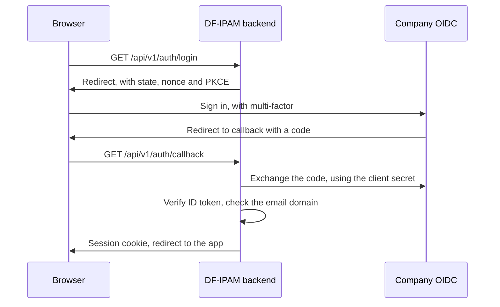

# Plan: simpler containers, company SSO, no Supabase

**Status:** proposed, nothing built yet. Phase 1 can start now. Phases 2 to 6 wait for the answers in Phase 0.

## Goal

| Today | After |
| --- | --- |
| `db`, `api` and `worker` containers, plus the web app outside Docker | `db`, `backend` and `web` containers: one job each |
| Sign-in through Supabase, with a password | Sign-in through company OIDC SSO. DF-IPAM holds no passwords |
| Anyone with a Supabase account | Only `@dialogfinance.lk` and `@dialog.lk` |
| Supabase test database, keys and SQL bundle | Gone. PostgreSQL in Docker is the only database |
| Tokens in browser storage | A session cookie JavaScript can't read |

This also closes three open items: the missing password screen, the missing multi-factor sign-in, and the leaked `service_role` key.

## Why there are three containers today

`api` and `worker` are the same image running two programs. The API answers people, and the worker runs background jobs: syncs, reports, schedules, expiry and email. They were split so a slow job can't hurt the API. That matters less at this size, because the worker is a few timed loops.

A fourth, `migrate`, runs once and exits, so `docker ps` doesn't show it.

## Phase 0: Answers needed first

From the identity team:

| # | Question | Why it matters |
| --- | --- | --- |
| 1 | Which product is it: Entra ID, Keycloak, ADFS, Okta? | Claim names and logout differ |
| 2 | **Do `@dialogfinance.lk` and `@dialog.lk` sign in through the same provider?** | If not, the design needs two issuers |
| 3 | Issuer URL, client ID and client secret | The connection itself |
| 4 | Can it register `https://<host>/api/v1/auth/callback`, and `http://localhost:5173/api/v1/auth/callback` for development? | Sign-in fails otherwise |
| 5 | Which claim holds the work email, and is `email_verified` sent? | The domain rule depends on it |
| 6 | Is multi-factor enforced by the provider? | Meets the brief's "strong authentication" |
| 7 | Can the server reach the provider, and does it use a private CA? | Firewall and trust store |

From you:

| # | Decision | Recommendation |
| --- | --- | --- |
| 8 | Is everyone at `@dialog.lk` meant to sign in, or only some? | Allow sign-in, but they see nothing until given a role |
| 9 | Subdomains such as `@it.dialog.lk`? | No: exact domains only |
| 10 | Session length | 30 minutes idle, 10 hours at most |
| 11 | Git identity: new commits only, or rewrite old ones? | New commits only. Rewriting changes every commit ID |
| 12 | Delete the Supabase project after cutover? | Yes, after a week of stable sign-ins. It can't be undone |

## Phase 1: Containers

Doesn't depend on SSO, so it can start now.

### Backend: one container

1. Add `cmd/server`, which runs the HTTP server and the worker loops in one process.
2. Move the worker loops from `cmd/worker/main.go` into `internal/worker`, with a `Run(ctx)` entry point.
3. Recover from a panic in each loop, so a failed job can't stop the API.
4. Shut down cleanly: stop taking requests, let jobs finish, then close.
5. Add `WORKER_ENABLED`, default `true`, so the two can be separated again by configuration.
6. Use one service in `docker-compose.yml`, with a pool of 30 connections instead of 20 and 10.

**Costs of merging:** the API and jobs share memory and CPU, so a large report can slow screens, and a restart interrupts running jobs. Stuck reports and syncs are already recovered, and `SKIP LOCKED` keeps two backends safe if you scale later.

**`migrate` stays a separate one-shot step.** Folding it in would keep the database owner's password inside the always-running backend, undoing the app role's limits. It exits, so it never appears in `docker ps`.

### Frontend: one container

1. Add `web/Dockerfile`: build with Node, serve from an unprivileged Nginx image.
2. Move `deploy/nginx/df-ipam.conf` into this container, so TLS, rate limits, agent rules and the `/api/` proxy travel with it.
3. Mount certificates read-only, and publish only ports 80 and 443.
4. Stop publishing port 8080: the backend is then reachable only through `web`.
5. Keep Vite for development, for instant reloads.

**Check first:** rate limits, audit logs and the agent allowlist need the real client address. Confirm it reaches Nginx inside Docker. If it doesn't, use host networking for `web`, or keep Nginx on the host.

**Alternative rejected:** embedding the web app in the Go binary gives two containers, but loses Nginx's flood protection, or leaves it on the host outside Docker.

### Result

```text
df-ipam-web-1       ports 80, 443     the only way in
df-ipam-backend-1   no public port    API and worker
df-ipam-db-1        no public port    PostgreSQL
```

The database port moves from `127.0.0.1:5432` to an opt-in development override, because `make test-db` needs it.

## Phase 2: SSO on the backend

### How sign-in works

The backend does the sign-in, and the browser only ever holds a cookie.



A browser-only flow is simpler, but leaves tokens where a script bug could steal them. This system holds a map of a bank's network, so the backend flow is worth it.

### Work

1. Add `api/internal/auth/oidc.go`, using `coreos/go-oidc` and `golang.org/x/oauth2`.
2. Add routes outside the authenticated group: `GET /auth/login`, `GET /auth/callback`, `POST /auth/logout`. List them in the route guard test and `openapi.yaml`, as the agent routes are.
3. Replace bearer checks in `Authenticate` with a session lookup. Keep an interface, so API tests can still stub sign-in.
4. Keep the per-request user check, so deactivating someone still takes effect at once.
5. Limit sign-in routes with `httpx.RateLimit`.
6. Remove expired sessions in `internal/retention`.
7. Audit `auth.login`, `auth.logout` and `auth.login_denied`.

### Domain rule

```text
AUTH_ALLOWED_EMAIL_DOMAINS=dialogfinance.lk,dialog.lk
```

- Checked on the server, in the callback, even if the provider also restricts it.
- Lowercase the email, take the part after the last `@`, and require an **exact** match.
- Refused: `x@evil-dialog.lk`, `x@dialog.lk.evil.com`, `x@gmail.com`.
- `email_verified` must be true, where the provider sends it.
- The issuer is pinned. Never accept a multi-tenant "common" endpoint: anyone can claim an email there.
- **Passing the rule gives no access.** A new person lands on "Waiting for access" until someone assigns a role.
- Users are identified by the provider's `sub`, not by email, because emails change.

### Cookie and session

| Setting | Value |
| --- | --- |
| Cookie | `__Host-dfipam_session`, `Secure`, `HttpOnly`, `SameSite=Lax`, `Path=/` |
| Value | 256 random bits. Only a SHA-256 hash is stored, in `sessions` |
| Lifetime | Decision 10 |
| CSRF | Unsafe methods need a matching `Origin` and a custom header |
| CORS | Removed: the app and API share one origin |

**Known limit:** someone disabled at the company stays signed in until their session ends. Deactivate them in DF-IPAM for immediate effect. Refresh tokens could close this later.

### Migration 15

- Give `dfipam_app` access to `sessions` again: migration 14 removed it because the table was unused.
- Add `last_seen_at` to `sessions`, for the idle limit. It already has `token_hash`, `expires_at` and `revoked_at`.
- Add a unique index on `lower(users.email)`, because linking depends on it. It only holds one user today.

## Phase 3: SSO in the web app

1. Replace `web/src/lib/auth.ts` with sign-in redirect, sign-out and a session check.
2. Replace the sign-in form with one **Sign in with company account** button, and show a clear message when a domain is refused.
3. Remove the `Authorization` header from `web/src/lib/api.ts`, send cookies, and add the CSRF header.
4. Point the existing 401 handling at the sign-in page.
5. Remove `@supabase/supabase-js`, saving 55 KB gzipped, and its chunk in `vite.config.ts`.
6. Replace **Invite user** with **Add person**: enter a company email and roles before their first sign-in. This removes `supabase_admin.go` and the `service_role` key.

## Phase 4: Your account and existing data

There is one user, which keeps this small.

| Where | Now | After |
| --- | --- | --- |
| `users.email` | `wickramasinghe.erandika@gmail.com` | `hasitha.wickramasinghe@dialogfinance.lk` |
| `users.auth_provider` | `supabase` | `oidc` |
| `users.auth_subject` | Supabase ID | `pending:<email>`, replaced at first sign-in |
| Git `user.email` | Gmail | Company email, in line with decision 11 |

```sql
UPDATE users
SET email = 'hasitha.wickramasinghe@dialogfinance.lk', auth_provider = 'oidc',
    auth_subject = 'pending:hasitha.wickramasinghe@dialogfinance.lk'
WHERE email = 'wickramasinghe.erandika@gmail.com';
```

- Your user ID doesn't change, so your Super Administrator role, requests and history stay yours.
- At first sign-in, a verified email that matches a `pending:` row takes over that row, once only.
- **Run this at cutover, not before**, or Supabase sign-in stops working.
- Audit rows are append-only, so any old value holding the Gmail address stays as history.

**New installs:** the first person signs in, then gets the Super Administrator role through `make db-shell`, as today.

## Phase 5: Remove Supabase

39 files mention it.

| Area | Change |
| --- | --- |
| Code | Delete `api/internal/auth/supabase*.go` and `web/src/lib/auth.ts`'s Supabase code |
| SQL bundle | Delete `cmd/sqlbundle`, `internal/sqlbundle` and `api/sql/supabase-setup.sql` |
| Config | Remove `SUPABASE_*` and `AUTH_AUDIENCE` from env files, `config.go` and `docker-compose.yml`. Add `OIDC_ISSUER`, `OIDC_CLIENT_ID`, `OIDC_CLIENT_SECRET`, `OIDC_REDIRECT_URL` and `AUTH_ALLOWED_EMAIL_DOMAINS` |
| Makefile and CI | Remove `sql`, `test-db-supabase` and `migrate-supabase`, and clean `.github/workflows/ci.yml` |
| Nginx | Remove Supabase from `connect-src`, and allow the provider if needed |
| Tests | Remove the Supabase wording from `dbrules` and allocation fixtures |
| Load test | Replace `LOADTEST_TOKEN` with a session cookie |
| Migrations | Leave them. Applied migrations are never edited |

**Row level security stays.** The Data API is gone, but it is a free second layer if the app role is misused. The rules in `CLAUDE.md` change to match.

## Phase 6: Tests and documents

**Tests** use a fake OIDC server in Go, so they run without the real provider:

- A good sign-in creates a session, and signing out ends it.
- Bad `state`, bad `nonce`, wrong issuer, wrong audience, expired token and unsigned token are all refused.
- Each refused address in the domain rule, including uppercase and look-alikes.
- `email_verified: false` is refused.
- A pending row links once, and can't be taken twice.
- A request without the CSRF header is refused, and a deactivated user is refused at once.
- Agent sign-in still works, because agents use their own credentials.

**Documents:** rewrite `authentication.md`, and update `CLAUDE.md`, `architecture.md`, `deployment.md`, `setup.md`, `security.md`, `requirements.md`, `database.md`, `README.md` and the system guide.

## Cutover

1. Take a backup, and confirm a restore.
2. Deploy, and run migration 15.
3. Run the Phase 4 update.
4. Sign in with your company account, and confirm your role.
5. Have a second person sign in, and assign them a role.
6. Try one address from a refused domain.
7. After a week, delete the Supabase project, and remove its entries from `api/.env`.
8. Change `POSTGRES_PASSWORD` and `DFIPAM_APP_PASSWORD`, which deleting Supabase doesn't cover.

**Rollback:** redeploy the previous images, and reverse the Phase 4 update. Keep Supabase until step 7, so this stays possible.

## Risks

| Risk | Mitigation |
| --- | --- |
| `@dialog.lk` uses a different provider | Answer question 2 first. Two issuers is a contained change if planned early |
| The provider is down, so nobody can sign in | Sessions already open carry on. Keep a break-glass procedure in `runbooks.md` |
| The server can't reach the provider | Test from the server in Phase 0 |
| Docker hides the real client address | Check in Phase 1, before moving Nginx |
| A large report slows the API | Separate with `WORKER_ENABLED=false` on a second container |
| Everyone at `@dialog.lk` can create a user row | They see nothing, and rows are small. Revisit with decision 8 |

## Order

| Phase | Size | Waits for |
| --- | --- | --- |
| 0. Answers | Small | Identity team, you |
| 1. Containers | Medium | Nothing |
| 2. SSO backend | Large | Phase 0 |
| 3. SSO web | Medium | Phase 2 |
| 4. Your account | Small | Cutover |
| 5. Remove Supabase | Medium | Phases 2 and 3 |
| 6. Tests and documents | Medium | Alongside each phase |
